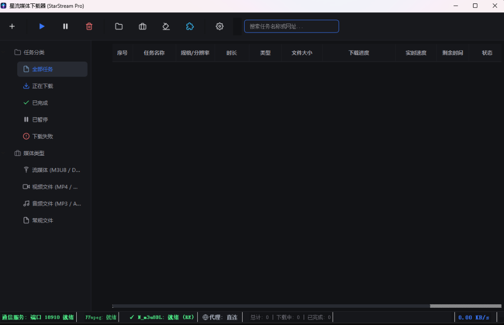
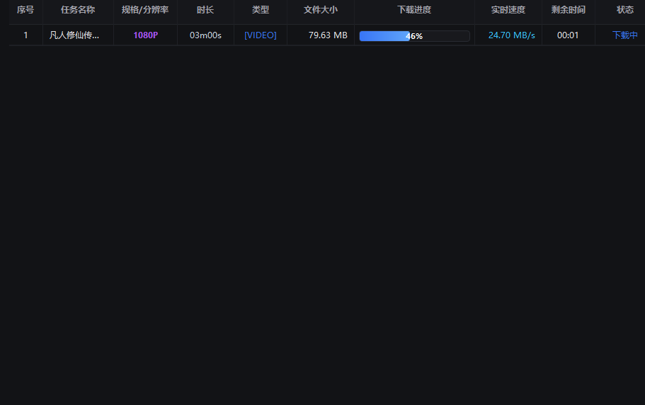
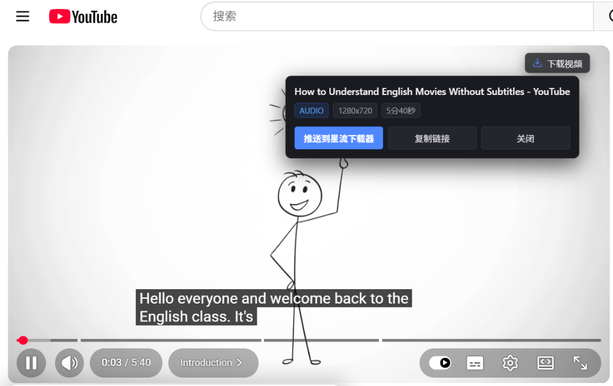
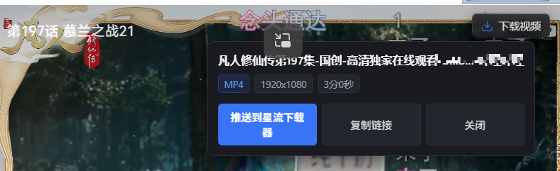
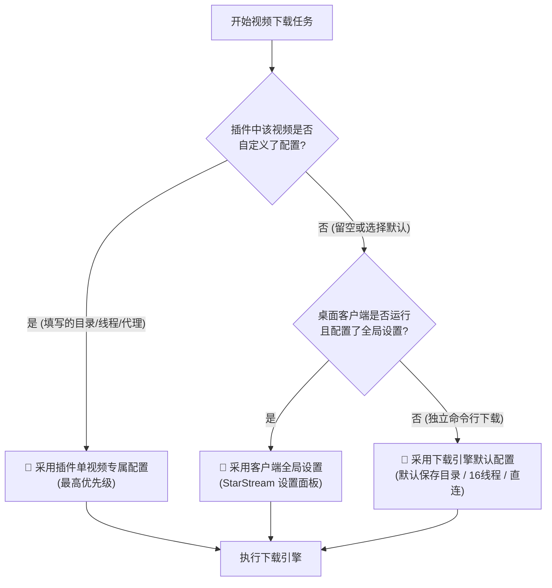

<div align="center">

<p align="center">
  
</p>

# 🌟 星流媒体下载器 (StarStream Pro)

**全能网页音视频智能嗅探扩展 + IDM 工业级多线程下载客户端 + 内置 N_m3u8DL-RE 与 FFmpeg 核心**

[](https://github.com/xuewexin/StarStream/releases)
[](#)
[](#)
[](#)
[](#)

<br>

<p align="center">
  <a href="https://github.com/xuewexin/StarStream/releases/download/v3.1.2/StarStream_v3.1.2_Portable.zip">
    
  </a>
  &nbsp;&nbsp;
  <a href="https://github.com/xuewexin/StarStream/releases/download/v3.1.2/StarStream_Browser_Extension_v3.1.2.zip">
    
  </a>
</p>

> [!IMPORTANT]
> ### 💡 黄金搭档使用说明：桌面软件必须搭配浏览器插件协同使用！
> - **🧩 浏览器嗅探插件（前端雷达）**：负责在您日常浏览网页、播放视频时，全自动深度抓取 M3U8、DASH (MPD)、MP4 等真实网络数据流，并在播放器右上角智能浮现【下载视频】操作胶囊；
> - **💻 桌面下载客户端（后端引擎）**：负责接收扩展推送的音视频任务，自动调度内置的 **N_m3u8DL-RE** 高性能引擎与 **FFmpeg** 核心，执行 24.7MB/s 工业级高并发分块下载与无损混流封装；
> - **二者协同配合（类似 IDM 软件与 IDM 浏览器扩展）**：缺一不可！初次使用请务必参考下方的 [浏览器插件导入教学](#-浏览器插件导入教学) 将扩展导入您的 Chrome/Edge 浏览器。

<p align="center">
  <a href="#-应用实机展示">实机展示</a> •
  <a href="#-软件版本与下载">版本下载</a> •
  <a href="#-核心特性">核心特性</a> •
  <a href="#-浏览器插件导入教学">插件教学</a> •
  <a href="#-代理网络配置说明">代理设置</a> •
  <a href="#-常见问题-faq">常见问题</a> •
  <a href="#-免责声明-disclaimer">免责声明</a>
</p>

</div>

---

## 📸 应用实机展示

### 1. 桌面端主控中心 (沉浸式 Slate 灰蓝工业级 UI)
> 彻底告别粗糙符号与简陋界面，全状态监控一目了然：本地监听端口 `18910` 就绪、`FFmpeg` 就绪、`N_m3u8DL (RE)` 引擎就绪、代理模式（直连 / 系统 / 手动）一键切换。

<p align="center">
  
</p>

---

### 2. 极速并发多任务下载 (实测 24.70 MB/s 极速分段拉取)
> 多任务队列并发调度，支持毫秒级断点续传。实时呈现分块下载百分比、动态传输速率（实测峰值达 **24.70 MB/s**）与秒级剩余时间估算。

<p align="center">
  
</p>

---

### 3. 海外流媒体无感嗅探 (以 YouTube 为例)
> 访问各类流媒体平台播放视频时，播放器右上角无感浮现【下载视频】胶囊。自动解析视频画质（如 1280x720）、独立 AUDIO 音频流与播放时长，支持一键推送到桌面端或复制真实链接。

<p align="center">
  
</p>

---

### 4. 国内主流视频网站智能嗅探与直推下载
> 播放网页视频时，智能捕获 1080P 高清规格与 MP4 格式，悬浮窗直观呈现视频参数，点击【推送到星流下载器】即刻自动唤醒客户端高速下载。

<p align="center">
  
</p>

---

## 📦 软件版本与下载 (Releases)

您可以通过以下方式轻松获取并使用星流媒体下载器最新发布版本：

| 下载方式 | 包含组件 | 适用场景 | 官方下载链接 |
|---|---|---|---|
| **⭐ 推荐：StarStream_v3.1.2_Portable.zip 全套便携包** | 内置完整 **StarStream.exe** + **N_m3u8DL-RE** + **FFmpeg** + 浏览器插件源码 | 免安装任何环境，解压即用，全套核心内置 | [👉 点击下载 Portable 便携包](https://github.com/xuewexin/StarStream/releases/download/v3.1.2/StarStream_v3.1.2_Portable.zip) |
| **🧩 必装搭档：浏览器嗅探插件独立包 (v3.1.2)** | 纯插件源码包 (仅 140KB)，含 MV3 嗅探/自动匹配浏览器代理/画质时长智能排序 | 嗅探网页视频、当前页面纯净展示、按时长画质降序置顶 | [👉 点击下载 Extension.zip (140KB)](https://github.com/xuewexin/StarStream/releases/download/v3.1.2/StarStream_Browser_Extension_v3.1.2.zip) |
| **GitHub Releases 官方发行版主页** | 查看所有发布版本、更新日志与资产列表 | 追溯所有更新与校验包 | [👉 访问 Releases 页面](https://github.com/xuewexin/StarStream/releases) |

> 💡 **提示**：独立版 exe **已打包内置最新的 N_m3u8DL-RE 引擎与 FFmpeg**，完全开箱即用，无需单独下载或配置外部命令行工具。
> 
> ### 🚀 v3.1.2 核心更新特性
> 1. **代理配置与系统设置核心直达**：主操作栏重构，次级工具收纳至「实用工具 ▾」下拉菜单，新增独立的「代理配置」与「系统设置」核心按钮，彻底告别宽屏窄屏按钮挤出溢出问题；
> 2. **全矢量 SVG/ICO 纯净图标重构**：全界面彻底剔除 Emoji 符号，所有功能按钮与状态指示全面采用高精度矢量图标，杜绝字符图标重复伪影；
> 3. **浏览器代理双向自动同步**：扩展插件默认开启「自动匹配浏览器代理」，无论当前浏览器走 Clash、v2rayN、系统全局还是直连，下载任务均实时同步；
> 4. **智能降速检测与动态连接刷新加速**：当文件瞬时下载速率低于本次传输历史峰值的 1/5 时，底层引擎自动刷新 TCP 连接链路与网络会话，有效突破 CDN 假死与降速限制；
> 5. **画质最高与时长最长正片智能优先**：插件悬浮下载按钮默认抓取画质最高、时长最长的正片流，自动过滤片头广告；
> 6. **插件视频列表纯净模式**：严格仅展示当前活动标签页抓取的音视频，并严格按【时长-画质】降序排列；
> 7. **开机版本检测与覆盖式热更新**：启动时自动异步静默核对版本，发现新版本弹窗提示更新日志，支持暂不更新与一键覆盖式热替换更新并自动重启；
> 8. **高对比度主题全景适配**：大修深色与浅色模式对比度样式，彻底解决文字与背景发黑看不清的使用体验问题。

---

## ⚡ 核心特性

| 功能模块 | 核心能力描述 |
|---|---|
| **全能资源嗅探** | 自动抓取 M3U8 (HLS)、MPD (DASH)、MP4、FLV、WebM、TS、MP3、AAC 等全部流媒体与直链；深度 Hook 网页 `HTMLMediaElement.play`、`Blob`、`MediaSource`、`URL.createObjectURL` 与 `fetch/XHR` |
| **智能悬浮胶囊** | 网页视频播放器内原生注入天蓝色悬浮操作胶囊，自动识别分集、清晰度规格（4K/1080P/720P）、时长与音轨分离流，一键投送客户端 |
| **弹窗内置播放器** | 扩展弹窗内置轻量 `hls.min.js` 播放引擎，支持在扩展弹窗中实时预览 M3U8 流媒体，核对画面音画无误后再发起下载 |
| **双下载引擎体系** | **流媒体引擎**：调度最新 [N_m3u8DL-RE](https://github.com/nilaoda/N_m3u8DL-RE) 高性能引擎，自动解析音视频混流并分段拉取；<br>**直链引擎**：原生 Python 多线程 Range 分块高并发下载 |
| **单视频专属配置** | 插件内每个视频卡片均支持展开专属配置面板，可针对特定视频单独指定**保存目录**、**并发线程数**（4/8/16/32）与**下载代理** |
| **浏览器代理自动对齐** | 插件自动检测当前浏览器实际代理地址，实现**下载网络出口与视频播放网页出口完全对齐**，彻底杜绝防盗链 IP 不一致导致的 HTTP 403 鉴权失败 |
| **脱离客户端独立运行** | 插件可与 `N_m3u8DL-RE` 直接搭配使用！一键生成并复制完整命令行，免启动桌面 exe 客户端亦可直接在终端中极速下载 |
| **批量格式转换中心** | 全新内置批量多媒体转换中心，支持多文件与整目录批量扫描，提供智能极速无损拷贝 (-c copy，秒级无损封装转码)、H.264/H.265/高品质音频提取等预设方案，支持多任务排队顺序转换、单文件与总体双重进度条 |
| **完成与失败弹窗提醒** | 任务下载完成或失败时，屏幕右下角自动弹出沉浸式浮窗提醒，支持直接点击【立即播放】、【打开目录】或失败时一键呼出【详细诊断与日志】 |
| **媒体格式自动处理** | 下载完成后自动调用内置 FFmpeg 进行无损转封装，生成通用 MP4 格式并注入 `faststart` 标记，确保任意播放器秒开起播 |
| **多节点代理网络池** | 全面支持 **直连**、**跟随 Windows 系统代理**、**手动多代理池**（兼容 Clash 7890、v2rayN 10808/10809/3080 及各类 HTTP/SOCKS5 本地端口代理），提供 TCP 端口探活与外网延迟测速 |
| **智能错误诊断与日志** | 遇到下载失败时自动记录错误日志至 `Logs/download_errors.log`，深度智能诊断失败根因（HTTP 403 防盗链/鉴权过期、401 未授权、404 不存在、AES-128 解密失败、代理端口未开启、DNS 解析失败、FFmpeg 合并异常等），提供清晰的排查建议与一键日志导出 |
| **自适应路径识别** | 软件全动态识别扩展源码所在的绝对路径，自动适配不同用户的电脑磁盘环境，杜绝死路径报错 |
| **磁盘缓存深度清理** | 内置磁盘清理向导，一键扫描并粉碎下载中断残留的 `.tmp`、`.part` 分片碎片，安全释放硬盘空间 |

---

## 💡 深度进阶：插件与 N_m3u8DL (mu3e) 独立搭配使用

星流媒体嗅探器不仅能与 StarStream 桌面客户端无缝协同，**还能直接与 N_m3u8DL-RE / N_m3u8DL-CLI (mu3e) 命令行工具完美脱离客户端独立搭配使用**！

### 场景与优势：
1. **无需启动客户端**：若您偏好命令行极客风格，或者在轻量化运行环境中，无需启动桌面 exe 客户端。
2. **一键生成并复制命令**：
   - 网页播放视频后，打开插件弹窗；
   - 点击任意视频卡片上的 **【复制命令】** 按钮（或展开【⚙️ 配置】点击【📋 复制 N_m3u8DL-RE 完整运行命令】）；
   - 扩展已自动为您拼装好全部关键参数：包含防盗链 `Referer` 头、`User-Agent`、自选保存名称、并发线程数、`-M format=mp4` 自动转封装以及自选的浏览器代理参数！
3. **极速运行**：直接在任意 CMD 或 PowerShell 窗口按 <kbd>Ctrl</kbd> + <kbd>V</kbd> 粘贴并回车，N_m3u8DL-RE 即刻全速开始下载与合并！

---

## 🎯 单视频独立配置与三级优先级机制 (Priority Rules)

为了满足专业用户对不同视频下载策略的精细化控制，星流构建了完备的**配置优先级覆盖机制**：



### 1. 🥇 最高优先级：插件单视频专属配置
- 点击插件卡片中的 **【⚙️ 配置】** 展开面板：
  - **📁 保存目录**：支持为当前视频指定专有存放路径（如 `D:\Movies\Anime`）；
  - **⚡ 并发线程**：自选 4 / 8 / 16 / 32 线程（对严格防爬的站点可降至 4 线程，普通站点拉满 32 线程）；
  - **🌐 下载代理**：可选“🎯 自动匹配浏览器代理”、“⚡ 直连”、“Clash 7890”、“v2rayN 10808”或自定义特定代理。

### 2. 🥈 次高优先级：桌面客户端全局设置
- 若插件中配置项留空或选择“跟随客户端设置”，系统自动读取桌面端【设置】面板中的全局配置（保存目录、默认线程数、代理模式）。

### 3. 🥉 默认兜底级：引擎标准默认配置
- 若未启动客户端且通过插件导出的命令行直接执行，自动回退到引擎标准配置（保存至当前 `Downloads` 目录、16 线程、直连）。

---

## 🌐 浏览器代理自动检测与对齐功能

### 为什么需要让下载环境与浏览器处于同一代理？
* 许多海外流媒体平台（如 YouTube、X/Twitter 等）以及部分国内限制版权流媒体，在网页端播放时使用的是浏览器专属的代理通道。
* 视频服务器下发给网页的 M3U8 切片清单往往包含与**当前访问 IP 强绑定的防盗链 Token 鉴权凭证**。
* **如果桌面下载器使用直连、或与浏览器走不同的代理出口 IP，就会触发目标站点的防盗链风控，导致 HTTP 403 权限被拒绝或分片拉取失败！**

### 自动对齐工作原理：
1. **智能嗅探当前代理**：插件内置 `chrome.proxy` 状态分析模块，自动检测当前浏览器生效的代理模式（无论是 Clash、v2rayN、SwitchyOmega 分流还是系统代理）。
2. **下载环境无缝同源**：下载时选择 **【🎯 自动匹配浏览器代理】**（默认推荐），插件将提取出的准确代理通道传递给下载引擎，确保**下载请求所使用的网络节点与网页播放时完全一致**，从根源上彻底解决 403 防盗链与鉴权失效难题！

---

## 🧩 浏览器插件导入教学

> ⚠️ **重要提示**：现代 Chromium 浏览器（Microsoft Edge / Google Chrome / Brave）出于安全防护机制，已拦截外部直接双击安装 `.crx` 安装包（会提示“无效的程序包”）。**官方唯一长期稳定、永久生效的导入方式是通过「开发者模式」加载文件夹**，只需 3 步即可轻松完成！

### 第一步：打开浏览器的扩展管理页
- **Edge 浏览器**：在地址栏输入 `edge://extensions` 并回车
- **Chrome 浏览器**：在地址栏输入 `chrome://extensions` 并回车

> 💡 **小贴士**：在星流客户端中点击「打开扩展页面」时，软件会**自动将扩展地址复制到剪贴板**，您只需在浏览器顶部地址栏按 <kbd>Ctrl</kbd> + <kbd>V</kbd> 粘贴并回车即可直达！

---

### 第二步：开启「开发者模式」
- 在扩展管理页面的**右上角**（或 Edge 页面左侧菜单栏底部），找到 **【开发者模式】(Developer mode)** 开关，点击开启。
- 开启后，页面左上方将出现 **【加载已解压的扩展程序】** 按钮。

---

### 第三步：选择扩展源码目录
1. 点击左上角的 **【加载已解压的扩展程序】** 按钮。
2. 在弹出的文件选择器中，定位并选中 **`m3u8-sniffer-extension`** 文件夹：
   - 若您单独下载了 [插件独立包 Extension.zip](https://github.com/xuewexin/StarStream/releases/download/v2.2.0/StarStream_Browser_Extension_v2.2.0.zip)，将其解压后直接选中解压得到的文件夹即可；
   - 若您使用的是便携全套包或克隆了仓库，直接选中根目录下的 `m3u8-sniffer-extension` 文件夹（您亦可在星流客户端设置中一键复制当前电脑上的准确路径）。
3. 点击「选择文件夹」，插件即刻导入成功！
4. 点击浏览器右上角的拼图图标 🧩，将 **「星流媒体嗅探器」** 固定到工具栏即可开始使用。

---

## 🌐 代理网络配置说明

星流媒体下载器针对国内国际网络环境进行了专门优化，支持以下三种代理模式：

1. **直接连接 (Direct)**：不使用任何网络代理，直接请求目标服务器。流媒体引擎自动禁用系统默认代理，保障国内高速源不走绕路。
2. **跟随系统代理 (System)**：全自动捕获 Windows 当前开启的全局或系统代理端口，无需手动配置。
3. **手动多节点代理池 (Manual)**：
   - 适配本地客户端（如 Clash 监听 `127.0.0.1:7890`、v2rayN 监听 `127.0.0.1:10809` 或 SOCKS5 `127.0.0.1:10808` / `127.0.0.1:3080`）。
   - **智能容错与补全**：若直接输入 `127.0.0.1:7890`，系统将自动补全协议并兼容 HTTP 与 SOCKS5。
   - **TCP 探活与诊断**：点击「测试」按钮时，系统首先探测本地端口是否处于监听状态；若客户端未开启，将清晰给出排查提示，避免盲目排错。

---

## 🚀 开发者运行方式 (源码启动)

如果您希望在 Python 环境中调试或二次开发：

```bash
# 1. 克隆代码仓库
git clone https://github.com/xuewexin/StarStream.git
cd StarStream

# 2. 安装项目依赖
pip install -r requirements.txt

# 3. 运行主程序
python run_app.py

# 或在 Windows 下双击运行：
启动星流下载器.bat
```

---

## 📁 目录结构

```
StarStream-Pro/
├── StarStream.exe              # [官方推荐] 单文件独立可执行程序 (内置全部引擎)
├── run_app.py                  # Python 桌面客户端入口
├── start.bat                   # 跨平台标准启动批处理
├── 启动星流下载器.bat           # Windows 中文快捷启动脚本
├── requirements.txt            # Python 核心依赖清单
├── README.md                   # 官方详细图文说明文档
│
├── catcatch_app/               # 桌面客户端核心源代码
│   ├── main.py                 # 客户端主界面逻辑与生命周期
│   ├── core/                   # 核心服务 (多线程下载/代理池/FFmpeg引擎/本地HTTP服务)
│   ├── resources/              # 官方 Logo 图标与本地交互 HTML 引导
│   └── ui/                     # 现代化 PyQt5 界面交互组件与矢量 SVG 资源
│
├── m3u8-sniffer-extension/     # 浏览器 MV3 网页嗅探扩展源码
│   ├── manifest.json           # 扩展配置清单
│   ├── background.js           # 跨域拦截与数据总线
│   ├── content_script.js       # 网页 DOM 悬浮胶囊交互层
│   └── popup/                  # 扩展交互弹窗与内置 HLS 播放器
│
└── docs/images/                # 项目界面高清展示截图与官方 Logo
```

---

## ❓ 常见问题 (FAQ)

<details>
<summary><b>1. 下载的 exe 安装包里面包含 N_m3u8DL-RE 引擎吗？</b></summary>
<p>
<b>包含！完全内置，免外部配置。</b><br>
本项目的独立发行版 <code>StarStream.exe</code> 已<b>完整内置最新的 N_m3u8DL-RE 高性能引擎与 FFmpeg 核心</b>。下载后双击即可直接使用，无需任何额外的命令行配置！<br>
若使用 Python 源码运行，客户端也会全自动全盘搜寻；若未检测到，状态栏会提供醒目的一键获取通道与全盘重探按钮。
</p>
</details>

<details>
<summary><b>2. 为什么扩展不打包成 .crx 文件直接拖动安装？</b></summary>
<p>
现代 Chromium 浏览器（Chrome / Edge / Brave）出于安全策略，全面禁止通过拖拽方式直接安装未上架 Google Web Store 的 <code>.crx</code> 包，并会强制报“程序包无效”或自动禁用。通过「开发者模式」加载源码文件夹是 Chromium 官方唯一保证稳定且长期生效的标准方案。
</p>
</details>

<details>
<summary><b>3. 下载后的视频会自动转为 MP4 格式吗？</b></summary>
<p>
是的！星流媒体下载器默认开启【自动转为标准 MP4 格式】，内置集成 FFmpeg 进行无损封装合并，并自动写入 <code>faststart</code> 元数据标记，确保在所有主流播放器与手机移动端均可秒开起播。
</p>
</details>

<details>
<summary><b>4. 本地代理端口测试失败如何解决？</b></summary>
<p>
请先确认您的代理软件（如 Clash、v2rayN）已启动且开启了“允许局域网连接”或本地监听。星流下载器具备自动端口诊断功能，可分别测试 TCP 端口监听与 HTTP/SOCKS5 外网通道。输入代理端口时支持简写（如 <code>127.0.0.1:7890</code>），系统将自动适配。
</p>
</details>

<details>
<summary><b>5. 我可以脱离桌面客户端，只用浏览器插件和 N_m3u8DL-RE 命令行直接下载吗？</b></summary>
<p>
<b>完全可以！</b><br>
嗅探到流媒体后，在插件弹窗中点击【复制命令】，插件会自动提取防盗链 <code>Referer</code>、<code>User-Agent</code>、清晰度、自选线程与自选代理，组合成完整的 <code>N_m3u8DL-RE "URL" ...</code> 命令行。无需启动 exe 桌面客户端，直接在任意终端粘贴回车即可极速下载并混流！
</p>
</details>

<details>
<summary><b>6. 为什么部分视频下载会报 HTTP 403 错误？如何使用“自动匹配浏览器代理”解决？</b></summary>
<p>
很多视频站点（特别是海外平台或带严格鉴权的防盗链站点）会将分片访问权限与<b>请求网页时的客户端出口 IP 强绑定</b>。如果浏览器使用了代理，而桌面下载器走直连或使用了不同出口 IP，就会被服务器安全策略判定为跨 IP 非法盗链，直接返回 403 Forbidden！<br>
<b>解决方案</b>：在插件单个视频下载配置中，将【下载代理】选择为<b>「🎯 自动匹配浏览器代理」</b>（默认），下载器会自动与浏览器对齐使用同一代理端口与出口 IP，从而彻底解除防盗链与鉴权限制。
</p>
</details>

---

## ⚖️ 免责声明 (Disclaimer)

在使用**星流媒体下载器 (StarStream Pro)** 及配套浏览器嗅探扩展前，请您务必仔细阅读并理解本声明：

1. **技术研究与个人学习**：本项目属于开源个人技术探索，旨在研究浏览器网络底层拦截机制、流媒体协议（HLS / DASH）解析技术与多线程分块下载算法，仅供计算机技术爱好者交流学习及个人合法离线备份之用。
2. **知识产权与版权保护**：请使用者严格遵守所在国家或地区的法律法规，自觉尊重原创作者及版权持有人的知识产权与合法权益。未经版权方明确书面授权许可，**严禁将通过本工具下载的任何视听内容用于商业盈利、公开转播、二次分发、非法盗版传播或其它任何侵犯版权的违法违规行为**。
3. **免责与法律责任界定**：本工具仅提供通用的客户端流媒体协议解析与本地存储技术，开发者不提供、不托管、亦不分发任何音视频资源。用户因使用本工具而导致的任何形式的直接或间接法律责任、版权纠纷、民事侵权或第三方经济损失，**均由使用者本人独立全权承担，开发者及贡献者不承担任何直接或连带法律责任**。
4. **合理使用原则**：若您通过本工具获取的媒体资源涉及第三方版权争议，请在测试或学习完成后 24 小时内自觉删除。如果您对某些资源的版权归属存疑，请立即停止下载与使用。

---

## 📄 开源许可证

本项目基于 [MIT License](LICENSE) 许可协议开源。<br>
致谢：[N_m3u8DL-RE](https://github.com/nilaoda/N_m3u8DL-RE) 与 [FFmpeg](https://ffmpeg.org/) 为音视频流媒体处理提供的卓越技术支持。
