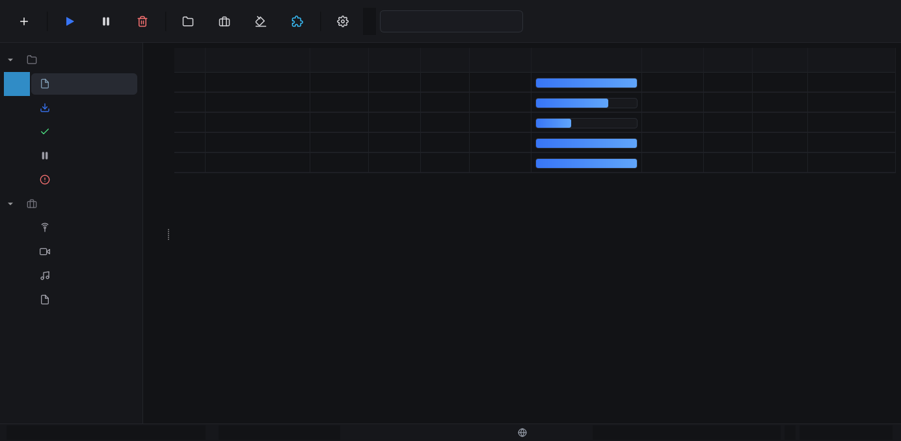
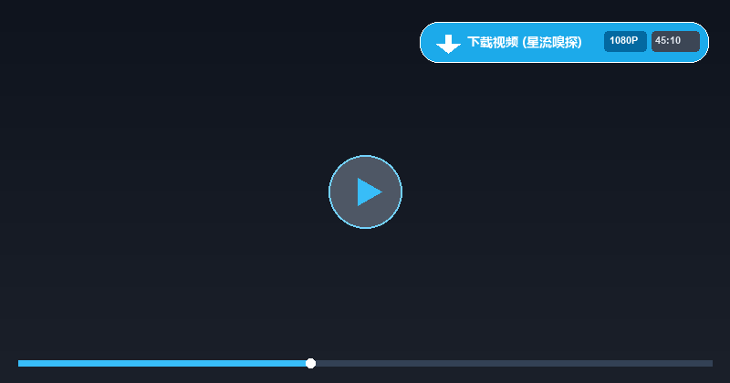
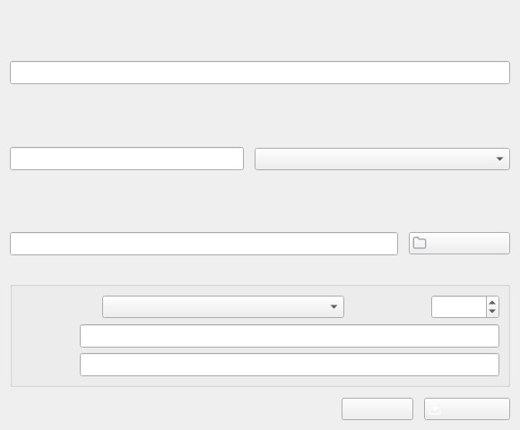
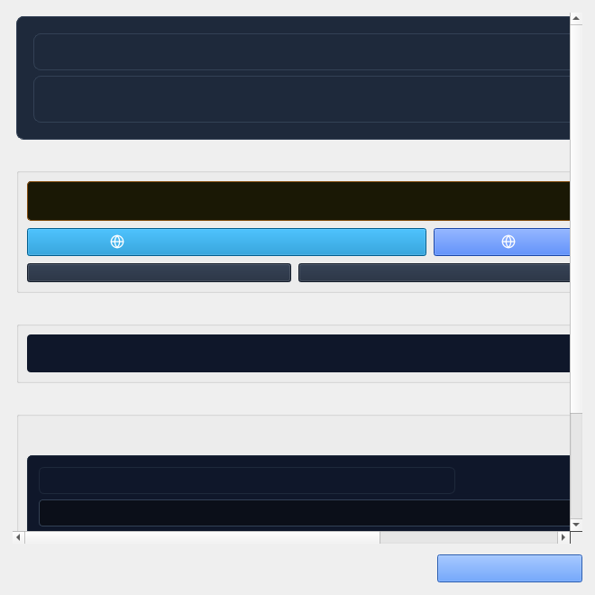
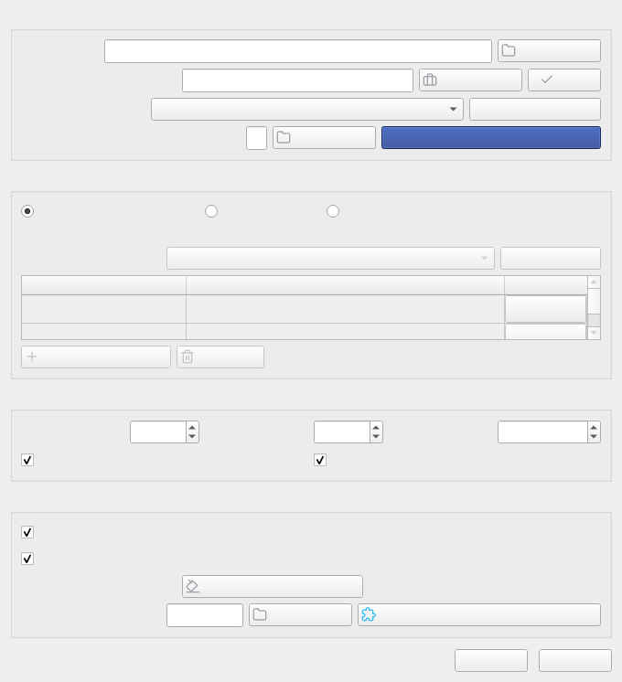

<div align="center">

# 🌟 星流媒体下载器 (StarStream Pro)

**全能网页音视频嗅探扩展 + IDM 工业级多线程下载客户端 + 内置 FFmpeg 媒体转封装核心**

[](#)
[](#)
[](#)
[](#)
[](#)

<p align="center">
  <a href="https://github.com/xuewexin/m3u8-sniffer/raw/main/StarStream.exe">
    
  </a>
</p>

<p align="center">
  <a href="#-应用展示">应用展示</a> •
  <a href="#-核心特性">核心特性</a> •
  <a href="#-浏览器插件导入教程">插件导入教学</a> •
  <a href="#-开箱即用运行方式">快速上手</a> •
  <a href="#-常见问题-faq">常见问题</a>
</p>

</div>

---

## 📸 应用与功能视觉展示

### 1. 桌面端多任务主控中心 (IDM 工业级深色灰蓝界面)
> 彻底摒弃粗糙的 Emoji 符号，采用沉浸式科技 Slate 灰蓝配色与全高清矢量 SVG 图标。支持多任务队列并发、断点续传、实时下载速率、多节点代理切换与 N_m3u8DL-RE 引擎状态指示。



---

### 2. 网页智能嗅探悬浮胶囊
> 在浏览器任意网页（各类视频网站、流媒体平台、在线教育等）播放音视频时，播放器右上角会自动浮现天蓝色【下载视频】胶囊，智能标注画质分辨率与时长，支持一键推送到桌面端极速下载。



---

### 3. 新建下载任务与多节点代理选择
> 支持输入 M3U8 流媒体 / MP4 直链，自定义任务标题、多线程并发数、请求头（Referer / Cookie），并支持为单个任务指定独立代理节点。



---

### 4. 插件安装指引与动态路径自适应
> 专为 Chromium 内核定制的安全跳转引导，全自动识别插件在您电脑上的实际物理路径，支持任意目录自由选择与一键复制路径秒选。



---

### 5. 多节点代理池与核心配置中心
> 支持直连、跟随系统代理、以及多节点代理池（Clash / v2rayN 等）自由切换，提供一键延迟测速与流媒体引擎全盘重新探测。



---

## ⚡ 核心特性

| 功能模块 | 核心能力描述 |
|---|---|
| **深度资源嗅探** | 自动抓取 M3U8 (HLS)、MPD (DASH)、MP4、FLV、WebM、TS、MP3、AAC 等全部流媒体与直链；深度 Hook 网页 `HTMLMediaElement.play`、`Blob`、`MediaSource`、`URL.createObjectURL` 与 `fetch/XHR` |
| **弹窗内置播放器** | 扩展弹窗集成轻量 `hls.min.js`，支持在扩展弹窗中直接预览播放捕获到的 M3U8 流媒体，核对无误后再下载 |
| **双下载引擎体系** | **流媒体引擎**：全自动动态搜寻并调度 [N_m3u8DL-RE](https://github.com/nilaoda/N_m3u8DL-RE) / CLI，实时捕获分片进度与速率；**直链引擎**：原生 Python 多线程 Range 分块高并发下载 |
| **媒体格式自动处理** | 下载完成后自动调用 FFmpeg 转封装为兼容性最佳的 MP4 格式，开启 `faststart` 秒开起播；保存文件名自动智能标注 `[分辨率]` 与 `[时长]` |
| **网络与代理池** | 免代理直连、跟随系统代理、手动多节点代理池（支持 Clash 7890、v2rayN 10808/10809 及自定义节点），支持单任务独立分配代理与一键测速 |
| **磁盘缓存深度清理** | 内置磁盘清理向导，一键扫描并安全粉碎下载失败残留的 `.tmp`、`.part` 碎片，释放硬盘空间 |

---

## 🧩 浏览器插件导入教程

> ⚠️ **重要提示**：现代 Chromium 浏览器（Microsoft Edge / Google Chrome）出于安全机制，已拦截外部直接运行 `.crx` 安装包（会提示“无效的程序包”）。**官方唯一长期有效、稳定且永久保留的安装方式为通过「开发者模式」加载文件夹**，只需 3 步即可轻松完成！

### 第一步：打开浏览器的扩展管理页
- **Edge 浏览器**：在地址栏输入 `edge://extensions` 并回车
- **Chrome 浏览器**：在地址栏输入 `chrome://extensions` 并回车

> 💡 **小贴士**：因浏览器安全沙箱限制外部程序直接强制跳转内部设置页，在星流客户端中点击「打开扩展页面」时，软件已**自动将扩展地址复制到剪贴板**，您只需在浏览器顶部地址栏按 <kbd>Ctrl</kbd> + <kbd>V</kbd> 粘贴并按回车即可直达！

---

### 第二步：开启「开发者模式」
- 在打开的扩展管理页面**右上角**（或 Edge 页面左侧菜单底部），找到 **【开发者模式】(Developer mode)** 开关，将其勾选开启。
- 开启后，页面左上方将出现 **【加载已解压的扩展程序】** 按钮。

---

### 第三步：选择本项目扩展源码目录
1. 点击左上角的 **【加载已解压的扩展程序】** 按钮。
2. 在弹出的文件选择器中，定位并选中本项目根目录下的 **`m3u8-sniffer-extension`** 文件夹。
3. 点击「选择文件夹」，插件即刻安装成功并永久生效！

---

### 第四步：固定到工具栏并开启极速嗅探
1. 点击浏览器右上角的拼图图标 🧩，将 **「星流媒体嗅探器」** 固定钉在工具栏。
2. 打开任意视频播放网页播放视频，播放器右上角便会自动浮现天蓝色 **【下载视频】** 胶囊，点击即可一键直推客户端高速下载！

---

## 🚀 开箱即用运行方式

### 方式一：直接运行独立安装包（免安装 Python，推荐）
👉 **[点击直接下载最新 StarStream.exe](https://github.com/xuewexin/m3u8-sniffer/raw/main/StarStream.exe)**

- **完整内置核心**：已将 `N_m3u8DL-RE` 与 `FFmpeg` 完整内置打包，单文件即可全功能运行。
- **无需任何配置**：下载完成后，直接双击 `StarStream.exe` 即可启动星流媒体下载器！
- 若您希望获取包含离线扩展文件夹的完整压缩包，可下载：[`StarStream_v2.0_Portable.zip`](https://github.com/xuewexin/m3u8-sniffer/releases)。

---

### 方式二：从源代码启动
如果您习惯使用 Python 环境运行：
```bash
# 1. 克隆代码仓库
git clone https://github.com/xuewexin/m3u8-sniffer.git
cd m3u8-sniffer

# 2. 安装项目依赖
pip install -r requirements.txt

# 3. 运行主程序 (任选一种方式)
python run_app.py
# 或在 Windows 下双击根目录运行：
启动星流下载器.bat
```

---

## 📁 目录文件结构

```
StarStream-Pro/
├── StarStream.exe              # [推荐] 独立单文件可执行程序 (打包产物)
├── run_app.py                  # 桌面客户端 Python 主入口
├── start.bat                   # 纯 ASCII 跨平台安全启动脚本
├── 启动星流下载器.bat           # Windows 中文快捷启动批处理
├── requirements.txt            # Python 核心依赖清单
├── README.md                   # 官方完整中文说明文档
│
├── catcatch_app/               # 桌面客户端核心源代码
│   ├── main.py                 # 客户端主界面逻辑与生命周期
│   ├── config.json             # 动态自适应配置文件 (杜绝死路径)
│   ├── core/                   # 核心逻辑 (多线程下载/代理/FFmpeg/本地服务)
│   ├── resources/              # 官方多尺寸高清图标与本地安装引导 HTML
│   └── ui/                     # 现代化 PyQt5 界面交互组件与矢量 SVG 图标
│
├── m3u8-sniffer-extension/     # 浏览器 MV3 网页嗅探扩展源码
│   ├── manifest.json           # 扩展配置清单 (MV3 规范)
│   ├── background.js           # 跨域网络拦截与事件总线核心
│   ├── content_script.js       # 网页 DOM 注入与悬浮胶囊交互层
│   └── popup/                  # 扩展交互弹窗与内置 HLS 播放器
│
└── docs/images/                # 项目界面高清展示截图
```

---

## ❓ 常见问题 (FAQ)

<details>
<summary><b>1. 提供的 exe 安装包里面包含 N_m3u8DL 引擎吗？</b></summary>
<p>
<b>包含！完全开箱即用。</b><br>
本项目的独立发行版 <code>StarStream.exe</code> 与绿色便携包 <code>StarStream_v2.0_Portable.zip</code> 已<b>将最新的 N_m3u8DL-RE 高性能引擎与 FFmpeg 核心完整打包内置</b>。下载后双击即可直接使用，无需单独下载配置任何外部 CLI 工具！<br>
若您使用 Python 源码运行，客户端也会全自动全盘搜寻；若未检测到，状态栏会提供醒目的一键获取通道与全盘重探按钮。
</p>
</details>

<details>
<summary><b>2. 为什么扩展不打包成 .crx 文件直接拖动安装？</b></summary>
<p>
现代 Chromium（Chrome / Edge）出于安全策略，全面禁止通过拖拽方式直接安装未上架 Google Web Store 的 <code>.crx</code> 包，并会报错“程序包无效”或强制禁用。通过「开发者模式」加载解压目录是官方唯一支持且不会失效的标准方案。
</p>
</details>

<details>
<summary><b>3. 下载后的视频会自动转为 MP4 吗？</b></summary>
<p>
是的！星流媒体下载器默认开启了【自动将下载的视频转为标准 MP4 格式】，内置集成 FFmpeg 无损混流与封装，并自动注入 <code>faststart</code> 标记，确保在所有播放器与移动设备上均可秒开起播。
</p>
</details>

---

## 📄 开源许可证

本项目基于 [MIT License](LICENSE) 许可协议开源。
感谢 [N_m3u8DL-RE](https://github.com/nilaoda/N_m3u8DL-RE) 与 [FFmpeg](https://ffmpeg.org/) 项目为流媒体处理提供的卓越技术支持。
