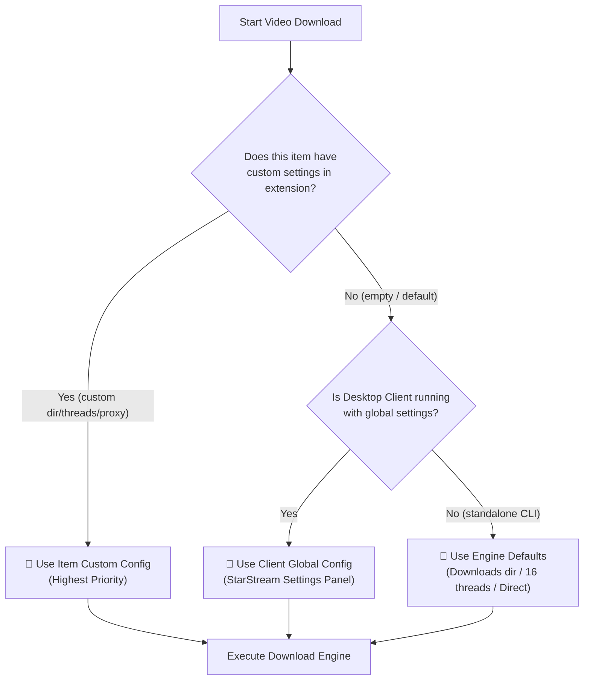

<div align="center">

<p align="center">
  <b>Language / 多语言:</b><br>
  <a href="README.md">简体中文</a> •
  <a href="README_zh-TW.md">繁體中文</a> •
  <a href="README_en.md">English</a> •
  <a href="README_ja.md">日本語</a> •
  <a href="README_ko.md">한국어</a> •
  <a href="README_fr.md">Français</a> •
  <a href="README_de.md">Deutsch</a> •
  <a href="README_es.md">Español</a> •
  <a href="README_ru.md">Русский</a> •
  <a href="README_pt.md">Português</a>
</p>

<p align="center">
  
</p>

# 🌟 StarStream Pro - Media Downloader

**All-in-One Web Audio/Video Sniffer Extension + Industrial Multithreaded Downloader Client + Built-in N_m3u8DL-RE & FFmpeg Core**

[](https://github.com/xuewexin/StarStream/releases)
[](#)
[](#)
[](#)
[](#)

<br>

<p align="center">
  <a href="https://github.com/xuewexin/StarStream/releases/download/v3.1.2/StarStream_v3.1.2_Portable.zip">
    
  </a>
  &nbsp;&nbsp;
  <a href="https://github.com/xuewexin/StarStream/releases/download/v3.1.2/StarStream_Browser_Extension_v3.1.2.zip">
    
  </a>
</p>

> [!IMPORTANT]
> ### 💡 Golden Duo Guide: Desktop Client + Browser Sniffer Working Together!
> - **🧩 Browser Sniffer Extension (Front-end Radar)**: Automatically intercepts and extracts real M3U8, DASH (MPD), and MP4 streams while you browse and play videos, displaying a sleek floating download capsule;
> - **💻 Desktop Downloader Client (Back-end Engine)**: Receives video tasks pushed from the extension, automatically invoking the built-in **N_m3u8DL-RE** high-performance engine and **FFmpeg** core for 24.7MB/s high-concurrency chunk downloads and lossless remuxing;
> - **Working in Synergy (like IDM Software & IDM Extension)**: Both are indispensable! For first-time use, please follow the [Browser Extension Setup Guide](#-browser-extension-setup-guide) below to install the extension in Chrome or Edge.

<p align="center">
  <a href="#-screenshots--showcase">Showcase</a> •
  <a href="#-releases--downloads">Downloads</a> •
  <a href="#-core-features">Features</a> •
  <a href="#-browser-extension-setup-guide">Extension Setup</a> •
  <a href="#-proxy-configuration">Proxy Setup</a> •
  <a href="#-frequently-asked-questions-faq">FAQ</a> •
  <a href="#-disclaimer">Disclaimer</a>
</p>

</div>

---

## 📸 Screenshots & Showcase

### 1. Desktop Dashboard (Modern Dark Slate Industrial UI)
> Crisp vector icons, full status monitoring at a glance: Local RPC port `18910` ready, `FFmpeg` ready, `N_m3u8DL (RE)` engine ready, real-time proxy status indicator, and instant mode switching.

<p align="center">
  
</p>

---

### 2. New Download Task & Deep URL Parsing (Per-Task Proxy & Thread Config)
> One-click paste and deep extraction for mainstream video URLs. Configure dedicated threads (4~32), custom save directories, and proxy network modes per task.

<p align="center">
  
</p>

---

### 3. FFmpeg Professional Multimedia Toolbox (Conversion & Post-Processing)
> Built-in out-of-the-box media workstation: Single & batch format conversion (MP4/MKV/TS/MOV), audio-video muxing, lossless audio extraction, fast video trimming, and stream probing.

<p align="center">
  
</p>

---

### 4. Seamless International Stream Sniffing (YouTube Example)
> A sleek floating capsule discreetly appears during video playback. Automatically captures real resolution, audio streams, duration, and pushes tasks directly via the identical proxy tunnel.

<p align="center">
  
</p>

---

### 5. Web Stream Sniffing & One-Click Push (Auto-Align Browser Proxy)
> A compact card surfaces genuine video resolutions, duration, and format. One-click aligns with browser proxy and dispatches high-speed downloads to the desktop client.

<p align="center">
  
</p>

---

### 6. Desktop Task Monitor & Quick Tools Hub
> Click the floating orb to expand the live monitoring dashboard: inspect active downloads, global transfer rate, and launch Batch Converter, FFmpeg Toolbox, or Video Extractor instantly.

<p align="center">
  
</p>

---

### 7. Futuristic Mini Celestial Floating Orb (Live Status Tracking)
> Sci-fi inspired mini planet widget with desktop dragging, edge snapping, and scaling. Stay updated on ready tasks, download progress, and global throughput at any time.

<p align="center">
  
</p>


## 📦 Releases & Downloads

| Download Option | Included Components | Best For | Link |
|---|---|---|---|
| **⭐ Recommended: StarStream_v3.1.2_Portable.zip** | Built-in **StarStream.exe** + **N_m3u8DL-RE** + **FFmpeg** + Extension Source | Portable, zero installation, all cores built-in | [👉 Download Portable Package](https://github.com/xuewexin/StarStream/releases/download/v3.1.2/StarStream_v3.1.2_Portable.zip) |
| **🧩 Standalone Extension Package (v3.1.2)** | Pure extension source (140KB), MV3 sniffing, Auto Proxy Matching, Sort by Duration | Web video sniffing, clean active-tab view, descending sort | [👉 Download Extension.zip](https://github.com/xuewexin/StarStream/releases/download/v3.1.2/StarStream_Browser_Extension_v3.1.2.zip) |
| **GitHub Releases Page** | View all release notes, history and asset checksums | Full version history | [👉 Visit Releases](https://github.com/xuewexin/StarStream/releases) |

> 💡 **Note**: The portable release package **already includes the latest N_m3u8DL-RE engine and FFmpeg**. It works out of the box with zero external configuration needed.

---

## ⚡ Core Features

| Module | Description |
|---|---|
| **Universal Sniffer** | Captures M3U8 (HLS), MPD (DASH), MP4, FLV, WebM, TS, MP3, AAC and more. Deeply hooks `HTMLMediaElement.play`, `Blob`, `MediaSource`, `URL.createObjectURL`, and `fetch/XHR`. |
| **Smart Capsule** | Native floating pill embedded directly on video players, identifying multi-resolution streams (4K/1080P/720P), duration, and audio-only streams for instant push. |
| **Built-in Preview** | Lightweight built-in `hls.min.js` player in the popup for instant stream preview before downloading. |
| **Dual Engine Core** | **Streaming Engine**: Invokes [N_m3u8DL-RE](https://github.com/nilaoda/N_m3u8DL-RE) for automatic A/V muxing and segment downloading.<br>**Direct Link Engine**: Native Python multi-threaded Range chunk downloader. |
| **Per-Video Config** | Customize save directory, concurrent threads (4/8/16/32), and specific download proxy per item. |
| **Auto Proxy Alignment** | Automatically matches browser proxy exit node with the downloader to avoid anti-hotlinking HTTP 403 Forbidden errors. |
| **Standalone CLI Support** | One-click generation and copying of full `N_m3u8DL-RE` CLI commands with Referer and User-Agent headers for headless running. |
| **Batch Format Converter** | Integrated batch media conversion center supporting lossless copy (`-c copy`), H.264/H.265 re-encoding, and audio extraction. |
| **Desktop Notifications** | Bottom-right desktop toasts on completion or failure with quick buttons for [Play Now], [Open Folder], or [Diagnostics]. |
| **Auto MP4 Remuxing** | Automatically invokes FFmpeg to remux downloaded streams to standard MP4 with `faststart` metadata for instant playback. |
| **Multi-Node Proxy Pool** | Direct, Windows System Proxy, and Manual Proxy Pool (Clash 7890, v2rayN 10808/10809/3080) with TCP port probing and latency ping. |
| **Smart Diagnostics** | Detailed error log analysis (`Logs/download_errors.log`) identifying 403 forbidden, expired tokens, AES-128 decryption issues, and DNS failures with actionable suggestions. |
| **Cache Cleanup** | Built-in disk cleaner to scan and purge residual `.tmp` and `.part` fragments to safely free up storage. |

---

## 🎯 Per-Video Custom Configuration & Priority Rules



---

## 🌐 Browser Proxy Auto-Alignment

### Why must the download environment match the browser proxy?
* Video streaming sites often tie segment authorization tokens directly to the client's **outbound IP address** during playback.
* If the browser connects through a proxy (e.g. Clash/v2rayN) while the desktop downloader connects directly or uses a different proxy node, the server's anti-hotlink security triggers an immediate **HTTP 403 Forbidden** error!
* **Solution**: Keep the download proxy set to **Auto Match Browser Proxy** (default). The extension extracts the active browser proxy node and synchronizes it with the engine.

---

## 🧩 Browser Extension Setup Guide

> ⚠️ Chromium browsers (Chrome, Edge, Brave) restrict direct `.crx` drag-and-drop installation for non-store packages. **Loading the unpacked extension via Developer Mode is the official, stable, and permanent installation method.**

### Step 1: Open Browser Extension Management Page
- **Microsoft Edge**: Enter `edge://extensions` in the address bar and press Enter.
- **Google Chrome**: Enter `chrome://extensions` in the address bar and press Enter.

### Step 2: Enable "Developer Mode"
- In the top right corner (or bottom left on Edge), toggle on **Developer mode**.
- The **[Load unpacked]** button will appear on the top left.

### Step 3: Select Extension Folder
1. Click **[Load unpacked]**.
2. Browse to and select the `m3u8-sniffer-extension` folder inside the project or unzipped package.
3. Click "Select Folder". The extension is now installed!
4. Click the puzzle icon 🧩 in your browser toolbar to pin **StarStream Media Sniffer**.

---

## 🚀 Running from Source (Developers)

```bash
# 1. Clone repository
git clone https://github.com/xuewexin/StarStream.git
cd StarStream

# 2. Install dependencies
pip install -r requirements.txt

# 3. Launch application
python run.py
```

---

## ❓ Frequently Asked Questions (FAQ)

<details>
<summary><b>1. Does the package include N_m3u8DL-RE and FFmpeg?</b></summary>
<p>
<b>Yes! Completely built-in.</b> The standalone portable package includes the latest N_m3u8DL-RE and FFmpeg binaries. It works right out of the box with no external setup required.
</p>
</details>

<details>
<summary><b>2. Will downloaded videos automatically convert to MP4?</b></summary>
<p>
Yes! StarStream automatically remuxes streams into standard MP4 format with <code>faststart</code> metadata so they play smoothly in any video player.
</p>
</details>

<details>
<summary><b>3. Why do some videos fail with HTTP 403?</b></summary>
<p>
This is caused by IP mismatch when accessing anti-hotlink protected streams. Keep the proxy setting as <b>Auto Match Browser Proxy</b> in the extension so both browser and downloader share the identical outbound IP address.
</p>
</details>

---

## ⚖️ Disclaimer

1. **Educational & Personal Use Only**: This project is developed for technical research and personal offline archiving.
2. **Copyright Protection**: Users must comply with applicable local laws and respect intellectual property rights. Do not distribute or monetize copyrighted content.
3. **Limitation of Liability**: The developers do not host or distribute any media streams. Users are solely responsible for their use of this software.

---

## 📄 License

Licensed under the [MIT License](LICENSE).  
Special thanks to [N_m3u8DL-RE](https://github.com/nilaoda/N_m3u8DL-RE) and [FFmpeg](https://ffmpeg.org/).
---

## 📬 Contact Author & Technical Support

If you encounter any issues, bugs, questions during use, or have valuable suggestions and feature requests, feel free to contact the author via email:

- **QQ Mail**: [2792893068@qq.com](mailto:2792893068@qq.com)
- **Gmail**: [lepa23216@gmail.com](mailto:lepa23216@gmail.com)

We will respond and address your questions and feedback as soon as possible! Thank you for your support!
