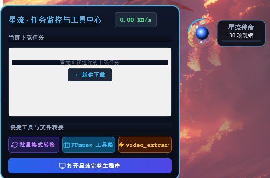

  <b>Language / Idiomas :</b> 
  <a href="README.md">简体中文</a> •
  <a href="README_zh-TW.md">繁體中文</a> •
  <a href="README_en.md">English</a> •
  <a href="README_ja.md">日本語</a> •
  <a href="README_ko.md">한국어</a> •
  <a href="README_fr.md">Français</a> •
  <a href="README_de.md">Deutsch</a> •
  <a href="README_es.md">Español</a> •
  <a href="README_ru.md">Русский</a> •
  <a href="README_pt.md">Português</a>

  

# StarStream Pro — Descargador de Medios

**Extensión Web Sniffer (MV3) · Cliente de Escritorio Multihilo · App Nativa para Android**

 

  
  &nbsp;&nbsp;
  
  &nbsp;&nbsp;
  
  &nbsp;&nbsp;
  

---

## 💡 ¿Por qué elegir StarStream Pro?

| Problema habitual | Solución técnica de StarStream Pro |
|---|---|
| Flujos de audio y vídeo separados sin sonido o fallo al unir | Emparejamiento automático multi-sitio + multiplexación sin pérdidas con **FFmpeg / FFmpegKit** a MP4 |
| Descarga tediosa de series y nombres poco claros | Rastreador por lotes que nombra cada archivo como **Título del vídeo + Episodio** |
| Bloqueos 403/412 y limitación de velocidad en CDN | Sincronización de `Cookie` / `Referer` y renovación automática de tokens para acelerar la descarga |
| Filtros fijos y espera para previsualizar | Lista editable de extensiones estilo IDM, reproducción mientras descarga y proxy para reproductor externo |

---

  

---

## 📸 Capturas Reales

  

<table>
  <tr>
    <td width="50%" align="center"> Captura flotante en reproductor web</td>
    <td width="50%" align="center"> Caja de herramientas FFmpeg integrada</td>
  </tr>
  <tr>
    <td width="50%" align="center"> Nueva tarea y configuración de proxy</td>
    <td width="50%" align="center"> Ajustes del sistema y mejora de vídeo</td>
  </tr>
  <tr>
    <td width="50%" align="center"> Panel monitor rápido de escritorio</td>
    <td width="50%" align="center"> Widget flotante de velocidad</td>
  </tr>
</table>

---

## 📱 Novedades en Android

- Navegador integrado multi-perfil, **renovación de identidad**, carpetas de marcadores plegables y restauración persistente de pestañas e historial.
- Reproducción simultánea mientras descarga y vista previa en reproductores externos.
- Límite de descargas simultáneas (1–6), multihilo (2–24) y ruta de almacenamiento personalizada (SAF).

Autor: `xuewexin` · [2792893068@qq.com](mailto:2792893068@qq.com) / [lepa23216@gmail.com](mailto:lepa23216@gmail.com) · Licencia MIT
