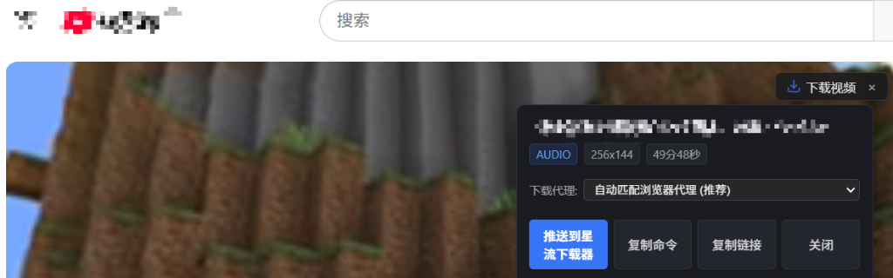

  <b>Language / Multilingue :</b> 
  <a href="README.md">简体中文</a> •
  <a href="README_zh-TW.md">繁體中文</a> •
  <a href="README_en.md">English</a> •
  <a href="README_ja.md">日本語</a> •
  <a href="README_ko.md">한국어</a> •
  <a href="README_fr.md">Français</a> •
  <a href="README_de.md">Deutsch</a> •
  <a href="README_es.md">Español</a> •
  <a href="README_ru.md">Русский</a> •
  <a href="README_pt.md">Português</a>

  

# StarStream Pro — Téléchargeur Multimédia

**Extension Web Sniffer (MV3) · Client Desktop Multithread · Application Native Android**

 

  
  &nbsp;&nbsp;
  
  &nbsp;&nbsp;
  
  &nbsp;&nbsp;
  

---

## 💡 Pourquoi choisir StarStream Pro ?

| Problème courant | Solution technique StarStream Pro |
|---|---|
| Flux audio/vidéo séparés sans son ou échec de fusion | Appairage automatique audio/vidéo multi-sites + multiplexage **FFmpeg / FFmpegKit** sans perte en MP4 |
| Téléchargement fastidieux de séries et nommage confus | Extraction par lots nommant chaque fichier selon **Titre vidéo + Épisode** |
| Erreurs anti-hotlink 403/412 et bridage CDN | Synchronisation `Cookie` / `Referer` / `UA` et rafraîchissement automatique des jetons pour débloquer le débit |
| Filtres rigides et attente avant lecture | Liste d'extensions éditable style IDM, lecture en cours de téléchargement et aperçu sur lecteur externe |

---

  

---

## 📸 Aperçu de l'application

  

<table>
  <tr>
    <td width="50%" align="center"> Capture flottante vidéo Web</td>
    <td width="50%" align="center"> Boîte à outils FFmpeg intégrée</td>
  </tr>
  <tr>
    <td width="50%" align="center"> Configuration des tâches et proxys</td>
    <td width="50%" align="center"> Paramètres avancés et amélioration vidéo</td>
  </tr>
  <tr>
    <td width="50%" align="center"> Moniteur rapide de bureau</td>
    <td width="50%" align="center"> Widget de vitesse flottant</td>
  </tr>
</table>

---

## 📱 Points forts Android

- Navigateur multi-moteur intégré, **actualisation d'identité**, dossiers de favoris pliables et historique persistant.
- Lecture en continu pendant le téléchargement (**Watch While Downloading**) et aperçu vidéo via lecteurs externes.
- Limite de tâches simultanées (1–6), multithreading (2–24) et dossier de sauvegarde personnalisé (SAF).

Auteur : `xuewexin` · [2792893068@qq.com](mailto:2792893068@qq.com) / [lepa23216@gmail.com](mailto:lepa23216@gmail.com) · Licence MIT
