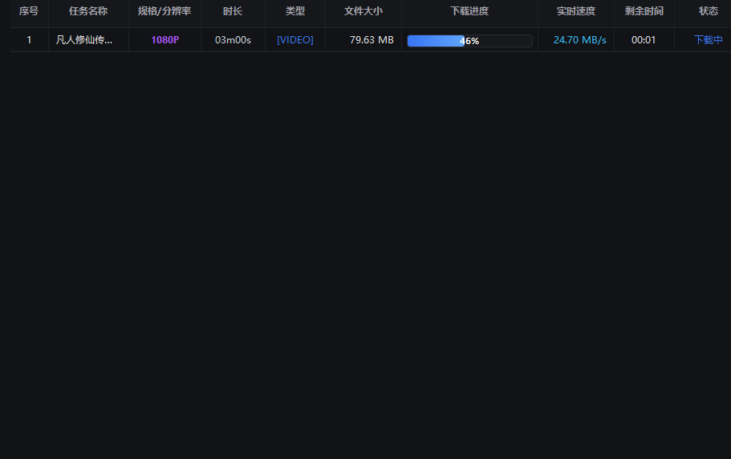

  <b>Language / Multilingue:</b> 
  <a href="README.md">简体中文</a> •
  <a href="README_zh-TW.md">繁體中文</a> •
  <a href="README_en.md">English</a> •
  <a href="README_ja.md">日本語</a> •
  <a href="README_ko.md">한국어</a> •
  <a href="README_fr.md">Français</a> •
  <a href="README_de.md">Deutsch</a> •
  <a href="README_es.md">Español</a> •
  <a href="README_ru.md">Русский</a> •
  <a href="README_pt.md">Português</a>

  

# 🌟 StarStream Pro - Téléchargeur Multimédia

**Extension de reniflage vidéo et audio Web tout-en-un + Client de téléchargement multithread industriel + Moteurs N_m3u8DL-RE et FFmpeg intégrés**

 

  
  &nbsp;&nbsp;
  

> [!IMPORTANT]
> ### 💡 Guide Duo Gagnant : Logiciel de bureau + Extension de navigateur !
> - **🧩 Extension de reniflage (Radar frontal)** : Intercepte automatiquement les flux réels M3U8, DASH (MPD) et MP4 lors de votre navigation Web et affiche une capsule de téléchargement pratique au-dessus du lecteur vidéo ;
> - **💻 Client de bureau (Moteur dorsal)** : Reçoit les tâches multimédias envoyées par l'extension et orchestre les moteurs intégrés **N_m3u8DL-RE** et **FFmpeg** pour télécharger à haute vitesse (jusqu'à 24.7 Mo/s) avec fusion sans perte ;
> - **Synergie parfaite (similaire à IDM et son extension)** : Les deux sont nécessaires ! Lors de la première utilisation, suivez les instructions du [Guide d'installation de l'extension](#-guide-dinstallation-de-lextension-navigateur) pour l'installer dans Chrome ou Edge.

  <a href="#-démonstration--captures-décran">Démonstration</a> •
  <a href="#-versions-et-téléchargements">Téléchargements</a> •
  <a href="#-fonctionnalités-clés">Fonctionnalités</a> •
  <a href="#-guide-dinstallation-de-lextension-navigateur">Guide Extension</a> •
  <a href="#-configuration-du-proxy">Proxy</a> •
  <a href="#-foire-aux-questions-faq">FAQ</a> •
  <a href="#-avertissement-légal">Avertissement</a>

---

## 📸 Démonstration & Captures d'écran

### 1. Tableau de bord de bureau (Interface industrielle Dark Slate)
> Surveillance complète en un coup d'œil : Port d'écoute local `18910` prêt, `FFmpeg` prêt, moteur `N_m3u8DL (RE)` prêt, et bascule de mode proxy (Direct / Système / Manuel) en un clic.

  

---

### 2. Téléchargement multitâche haute vitesse (Testé à 24.70 Mo/s)
> Planification de file d'attente multitâche avec reprise sur incident. Affiche la progression des segments, le débit en temps réel (pic testé à **24.70 Mo/s**) et l'estimation du temps restant.

  

---

### 3. Reniflage transparent de vidéos en ligne (Exemple YouTube)
> Lors de la lecture d'une vidéo sur des plateformes de streaming, la capsule flottante apparaît automatiquement en haut à droite du lecteur pour télécharger ou copier le lien direct.

  

---

## 📦 Versions et Téléchargements

| Option de téléchargement | Composants inclus | Cas d'utilisation | Lien |
|---|---|---|---|
| **⭐ Recommandé : StarStream_v3.1.2_Portable.zip** | **StarStream.exe** + **N_m3u8DL-RE** + **FFmpeg** + Code source extension | Version portable sans installation, tout inclus | [👉 Télécharger le pack portable](https://github.com/xuewexin/StarStream/releases/download/v3.1.2/StarStream_v3.1.2_Portable.zip) |
| **🧩 Extension Navigateur Seule (v3.1.2)** | Code source de l'extension (140 Ko), MV3, alignement proxy automatique | Détection vidéo Web, affichage clair de l'onglet actif | [👉 Télécharger Extension.zip](https://github.com/xuewexin/StarStream/releases/download/v3.1.2/StarStream_Browser_Extension_v3.1.2.zip) |
| **Page Officielle GitHub Releases** | Toutes les versions, notes de mise à jour et sommes de contrôle | Historique complet | [👉 Voir les Releases](https://github.com/xuewexin/StarStream/releases) |

---

## ⚡ Fonctionnalités Clés

| Module | Description |
|---|---|
| **Renifleur Universel** | Capture M3U8 (HLS), MPD (DASH), MP4, FLV, WebM, TS, MP3, AAC et liens directs. Intercepte `HTMLMediaElement.play`, `Blob`, `MediaSource`, `URL.createObjectURL`, `fetch/XHR`. |
| **Capsule Intelligente** | Bouton flottant incrusté dans le lecteur vidéo identifiant automatiquement la résolution (4K/1080P/720P), la durée et les pistes audio séparées. |
| **Lecteur Intégré** | Lecteur léger `hls.min.js` intégré dans le popup de l'extension pour prévisualiser les flux vidéo avant le téléchargement. |
| **Double Moteur** | **Moteur de streaming** : [N_m3u8DL-RE](https://github.com/nilaoda/N_m3u8DL-RE) pour le téléchargement par fragments et le multiplexage. **Moteur direct** : Téléchargement multithread Range en Python natif. |
| **Configuration par Vidéo** | Personnalisez le dossier de destination, le nombre de threads (4/8/16/32) et le proxy pour chaque vidéo. |
| **Alignement Proxy Automatique** | Synchronise le proxy du téléchargeur avec celui du navigateur pour éliminer les erreurs HTTP 403 Forbidden. |
| **Exécution en Ligne de Commande** | Génère et copie en un clic la commande complète `N_m3u8DL-RE` avec en-têtes Referer et User-Agent pour une exécution sans interface. |
| **Convertisseur de Formats** | Centre de conversion multimédia par lots : copie directe sans perte (`-c copy`), réencodage H.264/H.265 et extraction audio de haute qualité. |
| **Notifications de Bureau** | Popups de notification en bas à droite à la fin d'un téléchargement ou en cas d'erreur. |
| **Conversion MP4 Automatique** | Invoque FFmpeg pour convertir les flux téléchargés en MP4 standard avec métadonnées `faststart`. |
| **Diagnostic Intelligent** | Enregistre et analyse les erreurs (`Logs/download_errors.log`) pour fournir des conseils précis sur les codes 403, 401, clés AES-128 et pannes DNS. |
| **Nettoyage du Cache Disque** | Analyse et supprime les fragments résiduels `.tmp` et `.part` pour libérer de l'espace disque. |

---

## 🧩 Guide d'installation de l'extension navigateur

> ⚠️ Les navigateurs Chromium bloquent l'installation directe par glisser-déposer de fichiers `.crx` externes. **Le chargement via le « Mode développeur » est la méthode officielle et permanente.**

### Étape 1 : Ouvrir la page de gestion des extensions
- **Microsoft Edge** : Saisissez `edge://extensions` dans la barre d'adresse et validez.
- **Google Chrome** : Saisissez `chrome://extensions` dans la barre d'adresse et validez.

### Étape 2 : Activer le « Mode développeur »
- En haut à droite de la page, activez le bouton **Mode développeur** (Developer mode).
- Le bouton **[Charger l'extension non empaquetée]** apparaît alors.

### Étape 3 : Sélectionner le dossier de l'extension
1. Cliquez sur **[Charger l'extension non empaquetée]**.
2. Sélectionnez le dossier **`m3u8-sniffer-extension`**.
3. Validez la sélection. L'extension est maintenant installée !
4. Épinglez **StarStream Media Sniffer** dans votre barre d'outils.

---

## ⚖️ Avertissement Légal

1. **Recherche technique et usage personnel** : Ce projet est destiné à l'apprentissage des protocoles de streaming et aux sauvegardes légales personnelles hors ligne.
2. **Protection des droits d'auteur** : Veuillez respecter les lois sur la propriété intellectuelle de votre pays. Toute utilisation commerciale ou diffusion illégale de contenus protégés est strictement interdite.
3. **Limitation de responsabilité** : Cet outil ne fournit ni n'héberge aucun contenu multimédia. L'utilisateur assume l'entière responsabilité de son utilisation.

---

## 📄 Licence

Publié sous licence [MIT](LICENSE). Remerciements particuliers à [N_m3u8DL-RE](https://github.com/nilaoda/N_m3u8DL-RE) et [FFmpeg](https://ffmpeg.org/).
