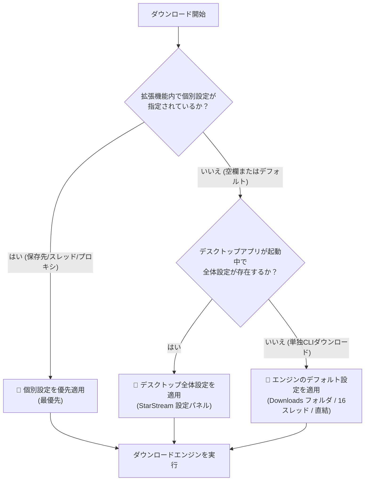

  <b>Language / 多言語:</b> 
  <a href="README.md">简体中文</a> •
  <a href="README_zh-TW.md">繁體中文</a> •
  <a href="README_en.md">English</a> •
  <a href="README_ja.md">日本語</a> •
  <a href="README_ko.md">한국어</a> •
  <a href="README_fr.md">Français</a> •
  <a href="README_de.md">Deutsch</a> •
  <a href="README_es.md">Español</a> •
  <a href="README_ru.md">Русский</a> •
  <a href="README_pt.md">Português</a>

  

# 🌟 StarStream Pro - メディアダウンローダー

**万能Web動画・音声スニファー拡張機能 + 工業用マルチスレッドダウンロードクライアント + N_m3u8DL-RE & FFmpegコア内蔵**

 

  
  &nbsp;&nbsp;
  
  &nbsp;&nbsp;
  
  &nbsp;&nbsp;
  

> [!IMPORTANT]
> ### 💡 ベストパートナー連携ガイド：デスクトップソフト＋ブラウザ拡張機能の連携必須！
> - **🧩 ブラウザ拡張機能（フロントエンド・レーダー）**：日常のWebブラウジングや動画再生中に、M3U8、DASH (MPD)、MP4などの実際のストリームデータを自動検知し、プレイヤー右上に「動画をダウンロード」カプセルを表示します；
> - **💻 デスクトップクライアント（バックエンド・エンジン）**：拡張機能からプッシュされたタスクを受け取り、内蔵の **N_m3u8DL-RE** 高性能エンジンと **FFmpeg** コアを自動起動して、実測24.7MB/sの高速マルチスレッド分割ダウンロードと無劣化マージを実行します；
> - **シームレスな連動（IDMソフトとIDMブラウザ拡張の関係と同様）**：両方揃って真価を発揮します。初回ご利用時は [ブラウザ拡張機能の導入手順](#-ブラウザ拡張機能の導入手順) に沿ってChromeまたはEdgeに拡張機能を追加してください。

  <a href="#-スクリーンショット--デモ">デモ画面</a> •
  <a href="#-バージョンとダウンロード">ダウンロード</a> •
  <a href="#-主な機能">主な機能</a> •
  <a href="#-ブラウザ拡張機能の導入手順">導入手順</a> •
  <a href="#-プロキシネットワーク設定">プロキシ設定</a> •
  <a href="#-よくある質問-faq">よくある質問</a> •
  <a href="#-免責事項">免責事項</a>

---

## 📸 スクリーンショット & デモ

### 1. デスクトップダッシュボード (洗練された Dark Slate UI)
> ベクターアイコンを採用した見やすいインターフェース。通信ポート `18910`、`FFmpeg`、`N_m3u8DL (RE)` エンジンの稼働状態やプロキシ接続状態を一目で確認できます。

  

---

### 2. 新規ダウンロードタスク作成 (タスク別のプロキシ・スレッド設定)
> 動画URLをワンクリックで解析。タスクごとにスレッド数（4〜32）、保存先フォルダー、プロキシモード（ダイレクト / ローカル / グローバル設定）を柔軟に指定可能。

  

---

### 3. FFmpeg プロ仕様マルチメディアツールボックス (フォーマット変換・編集)
> インストール不要のメディア統合処理ツール：MP4/MKV/TSなどの単一・一括フォーマット変換、映像・音声結合、無音カット、無劣化切り出し、メディアストリーム解析に対応。

  

---

### 4. 海外ストリーミング自動検出 (YouTube の例)
> 動画再生中にプレイヤー右上にスマートなダウンロードバッジを表示。解像度や再生時間を確認し、ブラウザと同一のプロキシ経由でデスクトップアプリへ瞬時に転送。

  

---

### 5. Web動画の自動検出とダイレクトダウンロード (プロキシ自動同期)
> Web動画再生時に検出カードを表示。解像度や長さを確認し、ワンクリックでブラウザのプロキシと同期してデスクトップアプリで高速ダウンロードを開始。

  

---

### 6. タスク監視 & クイックツールハブ
> フローティングボールをクリックして監視パネルを展開：進行中のダウンロードタスク、合計転送速度、フォーマット変換、FFmpeg ツール、動画抽出を素早く起動。

  

---

### 7. デスクトップミニフローティングウィジェット (リアルタイム監視)
> デスクトップ上を自由に移動できるスタイリッシュな惑星型ウィジェット。画面端への自動吸着やサイズ調整に対応し、待機中タスクやダウンロード進捗を手軽に確認。

  

## 📦 バージョンとダウンロード

以下の方法で最新のStarStreamをダウンロードしてご利用いただけます：

| ダウンロード種別 | 同梱コンポーネント | 利用シーン | リンク |
|---|---|---|---|
| **⭐ 推奨：StarStream_v3.2.0_Portable.zip ポータブル版** | **StarStream.exe** + **N_m3u8DL-RE** + **FFmpeg** + 拡張機能ソース一式 | **FFmpeg / N_m3u8DL を未導入の方に最適**。解凍するだけですぐ使えます | [👉 ポータブル版をダウンロード](https://github.com/xuewexin/StarStream/releases/download/v3.2.0/StarStream_v3.2.0_Portable.zip) |
| **🚀 単体実行ファイル版：StarStream.exe (77.5MB)** | 最新ビルド単体実行バイナリ | **すでに FFmpeg / N_m3u8DL をお持ちの方向け**。自動検出機能搭載。**必ず空の専用フォルダに入れて実行してください** | [👉 StarStream.exe を直接ダウンロード](https://github.com/xuewexin/StarStream/releases/download/v3.2.0/StarStream.exe) |
| **🧩 拡張機能単体パッケージ (v3.2.0)** | 拡張機能ソースのみ (165KB)、MV3検知、プロキシ自動整合、再生時間・画質順ソート | Web動画検知、アクティブタブ表示、降順ソート | [👉 Extension.zip (165KB) をダウンロード](https://github.com/xuewexin/StarStream/releases/download/v3.2.0/StarStream_Browser_Extension_v3.2.0.zip) |
| **GitHub Releases 公式リリースページ** | 全バージョン、更新履歴、アセットの確認 | 全リリース一覧の確認 | [👉 Releases ページへ](https://github.com/xuewexin/StarStream/releases) |

> 💡 **ダウンロードと利用に関する重要なお知らせ (必読ガイド)**:
> 1. **FFmpeg または N_m3u8DL を未導入の方**:
>    👉 **ポータブル版（`StarStream_v3.2.0_Portable.zip`）のダウンロードを推奨します**！必要な `ffmpeg.exe` および `N_m3u8DL-RE.exe` がすべて同梱されており、解凍するだけですぐにご利用いただけます。
> 2. **すでに FFmpeg や N_m3u8DL を環境にお持ちの方**:
>    👉 **単体実行ファイル（`StarStream.exe`）を直接ダウンロードしてご利用いただけます**！起動時にシステム環境変数（`PATH`）や標準フォルダーを自動スキャンし、既存のツールを自動検出して連携します。
> 3. **⚠️ 起動時の重要なお願い**:
>    単体版 `StarStream.exe` をご利用になる場合は、**必ず新しく作成した専用フォルダー（例：`D:\StarStream\`）に配置して実行してください**。起動時に設定ファイル、データベース、ログ、作業フォルダーが実行ファイルと同階層に自動生成されるため、専用フォルダーに置くことで管理や整理がスムーズになります。

---

## ⚔️ 類似オープンソース比較と移行ガイド (Alternatives & Comparison)

「StarStream（星流）」と「猫抓 (Cat-Catch)」「SimpleG」「N_m3u8DL-RE CLI」「yt-dlp」「Video DownloadHelper」の機能比較一覧です：

| 比較項目 | 🌟 StarStream Pro | 🐱 猫抓 (Cat-Catch) | 🛠️ SimpleG (原版GUI) | ⚡ yt-dlp / CLI | 🦊 Video DownloadHelper |
| :--- | :---: | :---: | :---: | :---: | :---: |
| **動作形態** | **デスクトップアプリ + 拡張機能の連携** | ブラウザ拡張機能のみ | 従来型Windowsアプリ | コマンドラインツール | 拡張機能 + 有料アプリ |
| **ダウンロードエンジン** | **N_m3u8DL-RE + FFmpeg を標準内蔵** | ブラウザ内蔵 Blob / Fetch | 旧 N_m3u8DL-CLI v3.0.2 | yt-dlp Python エンジン | 拡張機能内蔵 / 外部サービス |
| **マルチスレッド高速取得** | **✅ 対応 (4〜32スレッド並列、実測24MB/s超)** | ❌ 単一スレッド（大容量動画は低速） | ⚠️ 基本的なマルチスレッド | コマンドライン引数の指定が必要 | 有料ライセンスが必要 |
| **映像・音声の自動結合** | **✅ 自動混流・標準MP4形式へ無損変換** | ❌ 音声分離ストリームの合成不可 | ⚠️ 簡易結合 | FFmpegコマンドの併用が必要 | 無料版は時間制限や透かし |
| **プロキシ自動整合** | **✅ ブラウザのIPと完全同期 (403を完全防止)** | ブラウザ依存 | ❌ ブラウザのプロキシを検知不可 | 手動で `--proxy` 設定が必要 | ❌ 自動整合非対応 |
| **プレイヤー内蔵UI** | **✅ プレイヤー右上にダウンロードカプセル表示** | ❌ 拡張機能アイコンのクリック必須 | ❌ URLの手動コピー＆ペースト | ❌ コマンドライン入力 | 拡張機能アイコンをクリック |
| **デスクトップ常駐** | **✅ デスクトップ球形ウィジェット + ミニ監視** | ❌ なし | ❌ なし | ❌ なし | ❌ なし |
| **ライセンス** | **✅ 100% 無料・オープンソース (MIT)** | オープンソース | オープンソース | オープンソース (Unlicense) | 有料機能ありの商用ツール |

---

## ⚡ 主な機能

| 機能 | 詳細説明 |
|---|---|
| **万能リソーススニッフィング** | M3U8 (HLS)、MPD (DASH)、MP4、FLV、WebM、TS、MP3、AAC などの全ストリームおよび直接リンクに対応。`HTMLMediaElement.play`、`Blob`、`MediaSource`、`URL.createObjectURL`、`fetch/XHR` を深くインターセプト。 |
| **スマートフローティングカプセル** | プレイヤー内にシームレスに組み込まれる操作カプセル。4K/1080P/720Pの各画質、再生時間、音声分離ストリームを自動判別して送信。 |
| **ポップアップ内蔵プレイヤー** | 拡張機能のポップアップ内に軽量な `hls.min.js` 再生エンジンを搭載し、ダウンロード前にストリームの映像と音声を確認可能。 |
| **デュアルエンジン構成** | **ストリーミングエンジン**：最新 [N_m3u8DL-RE](https://github.com/nilaoda/N_m3u8DL-RE) を呼び出し、音声・映像の自動マージとセグメント並行取得を実施。 **直接リンクエンジン**：PythonネイティブのマルチスレッドRange分割ダウンロード。 |
| **動画ごとの個別設定** | 拡張機能内のカードごとに、保存先フォルダ、スレッド数（4/8/16/32）、プロキシを個別にカスタマイズ可能。 |
| **ブラウザプロキシ自動整合** | ブラウザが使用中のプロキシ環境を検知し、ダウンロードエンジンと完全に同期。IP不一致による HTTP 403 Forbidden エラーを根本的に防止。 |
| **クライアント不要のCLI連携** | 拡張機能から `N_m3u8DL-RE` 実行コマンドを一発生成・コピー可能。デスクトップアプリを起動せずにターミナルで直接高速ダウンロードも可能。 |
| **一括フォーマット変換センター** | 複数ファイルやフォルダの一括変換に対応。無劣化ストリームコピー (`-c copy`)、H.264/H.265 再エンコード、高音質音声抽出など多彩なプリセットを搭載。 |
| **完了・失敗デスクトップ通知** | ダウンロード完了時やエラー時に右下に通知を表示。「今すぐ再生」「フォルダを開く」「診断ログを表示」を直接操作可能。 |
| **MP4自動変換・最適化** | ダウンロード完了後にFFmpegを自動呼び出し、標準MP4形式への変換および `faststart` メタデータを付与し、即時再生を保証。 |
| **マルチノードプロキシプール** | 直接接続、Windowsシステムプロキシ、手動プロキシ（Clash 7890、v2rayN 10808/10809/3080等）に対応し、ポート死活監視と遅延測定を装備。 |
| **スマートエラー診断** | ダウンロード失敗時に `Logs/download_errors.log` へ記録し、HTTP 403、期限切れトークン、AES-128 復号エラー、DNS 失敗などを自動分析して対策を提示。 |
| **ディスクキャッシュ安全クリーン** | 中断されたダウンロードの `.tmp` や `.part` 断片ファイルを安全にスキャン・削除し、ストレージ容量を解放。 |

---

## 🎯 動画ごとの個別設定と優先順位ルール (Priority Rules)

---

## 🌐 ブラウザプロキシ自動整合機能

### なぜダウンロード環境とブラウザを同一プロキシに揃える必要があるのか？
* 動画配信サイトの多くは、動画セグメントのアクセス権限を**Web再生時のアクセス元IPアドレス**と強固に紐づけています。
* ブラウザがプロキシ経由でアクセスしている状態で、ダウンロードソフトが直接接続や異なるプロキシIPを使用すると、サーバーのセキュリティ検知により **HTTP 403 Forbidden（アクセス拒否）** が発生します！
* **解決策**：拡張機能の設定で **「利用可能なプロキシを自動整合」**（デフォルト推奨）を選択しておけば、ブラウザと同一の出口ノードが自動的に適用され、403エラーを完全に防ぐことができます。

---

## 🧩 ブラウザ拡張機能の導入手順

> ⚠️ Chromium系ブラウザ（Chrome / Edge / Brave）の仕様上、ストア外 `.crx` のドラッグ＆ドロップインストールはブロックされます。**「デベロッパーモード」によるフォルダ読み込みが公式推奨の永続導入方法です。**

### ステップ1：拡張機能の管理画面を開く
- **Microsoft Edge**：アドレスバーに `edge://extensions` と入力して Enter
- **Google Chrome**：アドレスバーに `chrome://extensions` と入力して Enter

### ステップ2：「デベロッパーモード」を有効化する
- 画面右上の **【デベロッパーモード】(Developer mode)** スイッチをオンにします。
- オンにすると、左上に **【パッケージ化されていない拡張機能を読み込む】** ボタンが表示されます。

### ステップ3：拡張機能のソースフォルダを選択
1. **【パッケージ化されていない拡張機能を読み込む】** をクリックします。
2. 解凍したパッケージ内の **`m3u8-sniffer-extension`** フォルダを選択します。
3. 「フォルダーの選択」をクリックすれば導入完了です！
4. ブラウザ右上のパズルアイコン 🧩 をクリックし、**「星流メディアスニファー」** をツールバーに固定してください。

---

## ❓ よくある質問 (FAQ)

<b>1. パッケージに N_m3u8DL-RE と FFmpeg は含まれていますか？</b>

<b>はい、完全に内蔵されています。</b> ポータブル版 <code>StarStream.exe</code> には最新の N_m3u8DL-RE と FFmpeg が同梱されており、追加の外部環境設定なしですぐに使えます。

<b>2. ダウンロードした動画は自動的にMP4に変換されますか？</b>

はい！StarStreamはデフォルトで標準MP4への自動変換が有効になっており、内蔵のFFmpegにより無劣化でマージされ、<code>faststart</code> メタデータが付与されるため、一般的なプレイヤーで快適に再生できます。

<b>3. 一部の動画で HTTP 403 エラーが発生する原因と対策は？</b>

再生時とダウンロード時のIPアドレス不一致が原因です。拡張機能のダウンロード設定で<b>「ブラウザプロキシを自動整合」</b>を選択しておけば、同一の出口IPが使用され、403エラーを回避できます。

---

## ⚖️ 免責事項

1. **技術研究および個人利用**：本プロジェクトはオープンソースの技術探究であり、ブラウザネットワークの傍受技術やストリーミングプロトコルの解析研究、合法的な個人オフラインバックアップを目的としています。
2. **著作権の保護**：ユーザーは各国の法令を遵守し、著作権者の権利を尊重してください。許可のない商用利用、再配布、著作権侵害行為は固く禁止します。
3. **責任の制限**：本ツールはプロトコル解析およびローカル保存技術のみを提供し、動画リソースの配布・ホスティングは一切行いません。本ツールの利用により生じた責任は利用者が負うものとします。

---

## 📄 ライセンス

本プロジェクトは [MIT License](LICENSE) の下で公開されています。 
謝辞：[N_m3u8DL-RE](https://github.com/nilaoda/N_m3u8DL-RE) および [FFmpeg](https://ffmpeg.org/)。
---

## 📬 作者へのお問い合わせ・サポート

ご利用中に問題や不具合、ご不明な点が発生した場合、または機能改善のご提案やご要望がございましたら、いつでもお気軽に作者までメールでお問い合わせください：

- **QQメール**: [2792893068@qq.com](mailto:2792893068@qq.com)
- **Gmail**: [lepa23216@gmail.com](mailto:lepa23216@gmail.com)

メールを確認次第、迅速に回答および対応いたします。皆様の応援とフィードバックに心より感謝申し上げます！

---

### 🏷️ Search Topics & SEO Keywords
`m3u8-downloader` • `video-downloader` • `catcatch-alternative` • `n-m3u8dl-re-gui` • `simpleg-upgrade` • `ffmpeg-gui` • `hls-stream-sniffer` • `dash-mpd-downloader` • `browser-extension` • `bilibili-video-download` • `douyin-watermark-free` • `chrome-video-extractor` • `yt-dlp-gui` • `stream-recorder` • `idm-alternative` • `media-downloader` • `video-sniffer` • `hls-downloader`
