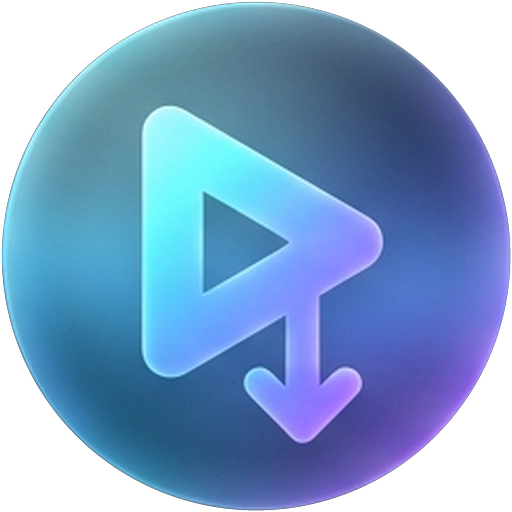
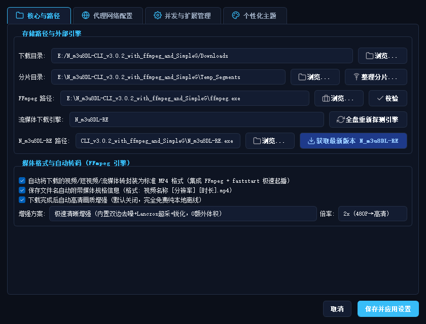

  <b>Language / 多言語:</b> 
  <a href="README.md">简体中文</a> •
  <a href="README_zh-TW.md">繁體中文</a> •
  <a href="README_en.md">English</a> •
  <a href="README_ja.md">日本語</a> •
  <a href="README_ko.md">한국어</a> •
  <a href="README_fr.md">Français</a> •
  <a href="README_de.md">Deutsch</a> •
  <a href="README_es.md">Español</a> •
  <a href="README_ru.md">Русский</a> •
  <a href="README_pt.md">Português</a>

  

  

# StarStream Pro - 高機能メディアダウンローダー

**Web メディアスニファー拡張機能 (MV3) · 高速マルチスレッドデスクトップ版 · ネイティブ Android クライアント**

 

  
  &nbsp;&nbsp;
  
  &nbsp;&nbsp;
  
  &nbsp;&nbsp;
  

---

## 📸 スクリーンショット

  

<table>
  <tr>
    <td width="50%" align="center"> Web 動画フローティングキャプチャ</td>
    <td width="50%" align="center"> 内蔵 FFmpeg メディアツールボックス</td>
  </tr>
  <tr>
    <td width="50%" align="center"> 新規タスク・プロキシ設定</td>
    <td width="50%" align="center"> スレッド・画質向上オプション設定</td>
  </tr>
  <tr>
    <td width="50%" align="center"> デスクトップモニターパネル</td>
    <td width="50%" align="center"> フローティング速度ウィジェット</td>
  </tr>
</table>

---

## 📱 Android 版の主な特徴

- **マルチカーネル内蔵ブラウザ & ID リフレッシュ** · プルダウン更新・折りたたみ式ブックマークフォルダ・閲覧履歴の永続保存。
- **ダウンロード中再生（追っかけ再生）＆ 外部プレーヤープレビュー**：ローカルストリーミングプロキシにより、ダウンロード中の視聴や外部プレイヤーでのオンライン再生が可能。
- **同時タスク数・マルチスレッド・保存先フォルダの自由設定**。

Author: `xuewexin` · [2792893068@qq.com](mailto:2792893068@qq.com) / [lepa23216@gmail.com](mailto:lepa23216@gmail.com) · MIT License
