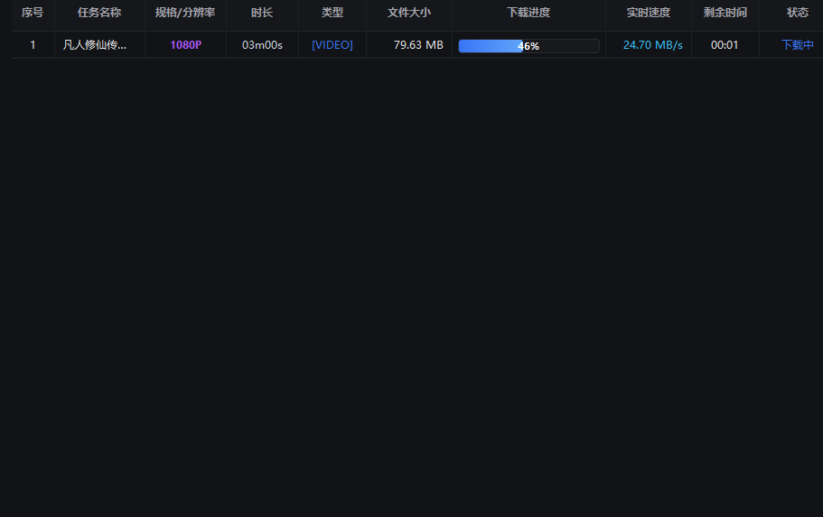
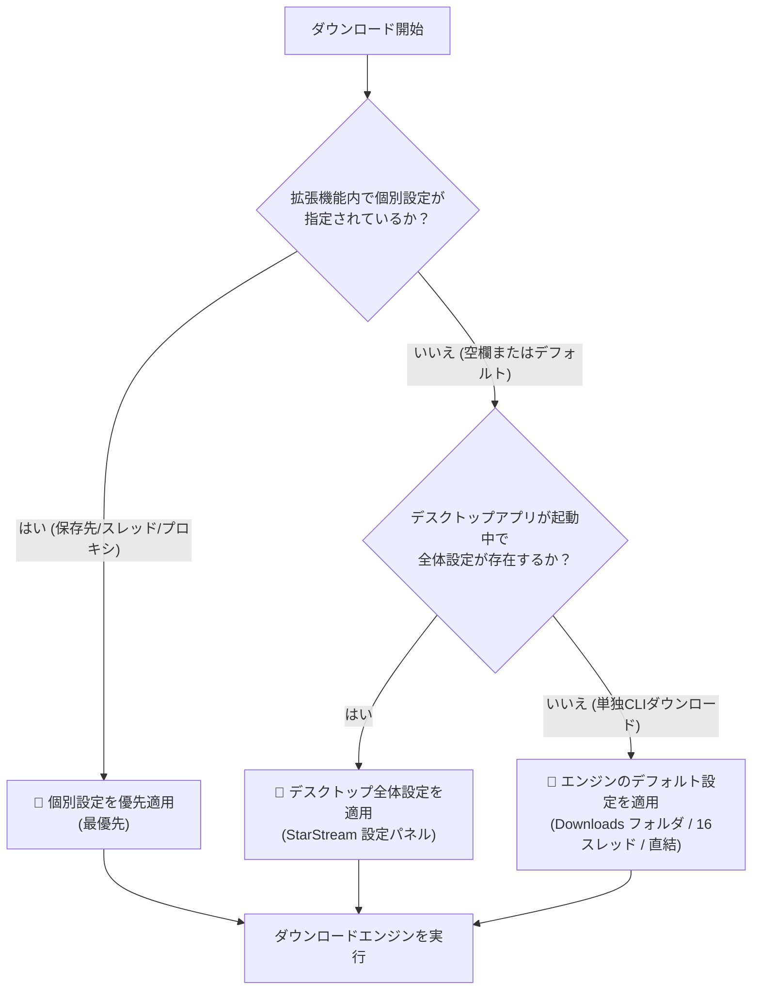

  <b>Language / 多言語:</b> 
  <a href="README.md">简体中文</a> •
  <a href="README_zh-TW.md">繁體中文</a> •
  <a href="README_en.md">English</a> •
  <a href="README_ja.md">日本語</a> •
  <a href="README_ko.md">한국어</a> •
  <a href="README_fr.md">Français</a> •
  <a href="README_de.md">Deutsch</a> •
  <a href="README_es.md">Español</a> •
  <a href="README_ru.md">Русский</a> •
  <a href="README_pt.md">Português</a>

  

# 🌟 StarStream Pro - メディアダウンローダー

**万能Web動画・音声スニファー拡張機能 + 工業用マルチスレッドダウンロードクライアント + N_m3u8DL-RE & FFmpegコア内蔵**

 

  
  &nbsp;&nbsp;
  

> [!IMPORTANT]
> ### 💡 ベストパートナー連携ガイド：デスクトップソフト＋ブラウザ拡張機能の連携必須！
> - **🧩 ブラウザ拡張機能（フロントエンド・レーダー）**：日常のWebブラウジングや動画再生中に、M3U8、DASH (MPD)、MP4などの実際のストリームデータを自動検知し、プレイヤー右上に「動画をダウンロード」カプセルを表示します；
> - **💻 デスクトップクライアント（バックエンド・エンジン）**：拡張機能からプッシュされたタスクを受け取り、内蔵の **N_m3u8DL-RE** 高性能エンジンと **FFmpeg** コアを自動起動して、実測24.7MB/sの高速マルチスレッド分割ダウンロードと無劣化マージを実行します；
> - **シームレスな連動（IDMソフトとIDMブラウザ拡張の関係と同様）**：両方揃って真価を発揮します。初回ご利用時は [ブラウザ拡張機能の導入手順](#-ブラウザ拡張機能の導入手順) に沿ってChromeまたはEdgeに拡張機能を追加してください。

  <a href="#-スクリーンショット--デモ">デモ画面</a> •
  <a href="#-バージョンとダウンロード">ダウンロード</a> •
  <a href="#-主な機能">主な機能</a> •
  <a href="#-ブラウザ拡張機能の導入手順">導入手順</a> •
  <a href="#-プロキシネットワーク設定">プロキシ設定</a> •
  <a href="#-よくある質問-faq">よくある質問</a> •
  <a href="#-免責事項">免責事項</a>

---

## 📸 スクリーンショット & デモ

### 1. デスクトップ管理センター (Slateダークブルーの工業デザインUI)
> 荒削りな記号や単調な画面とは決別し、全ステータスを一目で把握：ローカル待受ポート `18910` 稼働中、`FFmpeg` 準備完了、`N_m3u8DL (RE)` エンジン準備完了、プロキシモード（直接接続 / システム / 手動）ワンクリック切替可能。

  

---

### 2. 超高速・並行マルチタスクダウンロード (実測 24.70 MB/s)
> マルチタスクの自動スケジューリングとミリ秒単位のレジュームに対応。セグメントダウンロード進行状況、リアルタイム転送速度（実測ピーク **24.70 MB/s**）、秒単位の残り予測時間を表示します。

  

---

### 3. 海外ストリーミングのシームレス検知 (YouTubeを例に)
> 各種動画サイトで再生を開始すると、動画プレイヤーの右上に自動でフローティングカプセルが出現。解像度（例: 1280x720）、独立したAUDIO音声ストリーム、再生時間を自動検出し、ワンクリックでデスクトップ側に送信または直接URLをコピーできます。

  

---

### 4. 国内外主要動画サイトの自動検知と直接プッシュ
> 1080PフルHDストリームやMP4直リンクをインテリジェントに検知。フローティングウィンドウに動画仕様が直感的に表示され、「StarStreamへ転送」をクリックするだけでクライアントが自動起動します。

  

---

## 📦 バージョンとダウンロード

| ダウンロード種別 | 同梱コンポーネント | 利用シーン | リンク |
|---|---|---|---|
| **⭐ 推奨：StarStream_v3.1.2_Portable.zip ポータブル版** | **StarStream.exe** + **N_m3u8DL-RE** + **FFmpeg** + 拡張機能ソース一式 | インストール不要、解凍後すぐに全機能利用可能 | [👉 ポータブル版をダウンロード](https://github.com/xuewexin/StarStream/releases/download/v3.1.2/StarStream_v3.1.2_Portable.zip) |
| **🧩 拡張機能単体パッケージ (v3.1.2)** | 拡張機能ソースのみ (140KB)、MV3検知、プロキシ自動整合、再生時間・画質順ソート | Web動画検知、アクティブタブ表示、降順ソート | [👉 Extension.zip (140KB) をダウンロード](https://github.com/xuewexin/StarStream/releases/download/v3.1.2/StarStream_Browser_Extension_v3.1.2.zip) |
| **GitHub Releases 公式リリースページ** | 全バージョン、更新履歴、アセットの確認 | 全リリース一覧の確認 | [👉 Releases ページへ](https://github.com/xuewexin/StarStream/releases) |

---

## ⚡ 主な機能

| 機能 | 詳細説明 |
|---|---|
| **万能リソーススニッフィング** | M3U8 (HLS)、MPD (DASH)、MP4、FLV、WebM、TS、MP3、AAC などの全ストリームおよび直接リンクに対応。`HTMLMediaElement.play`、`Blob`、`MediaSource`、`URL.createObjectURL`、`fetch/XHR` を深くインターセプト。 |
| **スマートフローティングカプセル** | プレイヤー内にシームレスに組み込まれる操作カプセル。4K/1080P/720Pの各画質、再生時間、音声分離ストリームを自動判別して送信。 |
| **ポップアップ内蔵プレイヤー** | 拡張機能のポップアップ内に軽量な `hls.min.js` 再生エンジンを搭載し、ダウンロード前にストリームの映像と音声を確認可能。 |
| **デュアルエンジン構成** | **ストリーミングエンジン**：最新 [N_m3u8DL-RE](https://github.com/nilaoda/N_m3u8DL-RE) を呼び出し、音声・映像の自動マージとセグメント並行取得を実施。 **直接リンクエンジン**：PythonネイティブのマルチスレッドRange分割ダウンロード。 |
| **動画ごとの個別設定** | 拡張機能内のカードごとに、保存先フォルダ、スレッド数（4/8/16/32）、プロキシを個別にカスタマイズ可能。 |
| **ブラウザプロキシ自動整合** | ブラウザが使用中のプロキシ環境を検知し、ダウンロードエンジンと完全に同期。IP不一致による HTTP 403 Forbidden エラーを根本的に防止。 |
| **クライアント不要のCLI連携** | 拡張機能から `N_m3u8DL-RE` 実行コマンドを一発生成・コピー可能。デスクトップアプリを起動せずにターミナルで直接高速ダウンロードも可能。 |
| **一括フォーマット変換センター** | 複数ファイルやフォルダの一括変換に対応。無劣化ストリームコピー (`-c copy`)、H.264/H.265 再エンコード、高音質音声抽出など多彩なプリセットを搭載。 |
| **完了・失敗デスクトップ通知** | ダウンロード完了時やエラー時に右下に通知を表示。「今すぐ再生」「フォルダを開く」「診断ログを表示」を直接操作可能。 |
| **MP4自動変換・最適化** | ダウンロード完了後にFFmpegを自動呼び出し、標準MP4形式への変換および `faststart` メタデータを付与し、即時再生を保証。 |
| **マルチノードプロキシプール** | 直接接続、Windowsシステムプロキシ、手動プロキシ（Clash 7890、v2rayN 10808/10809/3080等）に対応し、ポート死活監視と遅延測定を装備。 |
| **スマートエラー診断** | ダウンロード失敗時に `Logs/download_errors.log` へ記録し、HTTP 403、期限切れトークン、AES-128 復号エラー、DNS 失敗などを自動分析して対策を提示。 |
| **ディスクキャッシュ安全クリーン** | 中断されたダウンロードの `.tmp` や `.part` 断片ファイルを安全にスキャン・削除し、ストレージ容量を解放。 |

---

## 🎯 動画ごとの個別設定と優先順位ルール (Priority Rules)

---

## 🌐 ブラウザプロキシ自動整合機能

### なぜダウンロード環境とブラウザを同一プロキシに揃える必要があるのか？
* 動画配信サイトの多くは、動画セグメントのアクセス権限を**Web再生時のアクセス元IPアドレス**と強固に紐づけています。
* ブラウザがプロキシ経由でアクセスしている状態で、ダウンロードソフトが直接接続や異なるプロキシIPを使用すると、サーバーのセキュリティ検知により **HTTP 403 Forbidden（アクセス拒否）** が発生します！
* **解決策**：拡張機能の設定で **「利用可能なプロキシを自動整合」**（デフォルト推奨）を選択しておけば、ブラウザと同一の出口ノードが自動的に適用され、403エラーを完全に防ぐことができます。

---

## 🧩 ブラウザ拡張機能の導入手順

> ⚠️ Chromium系ブラウザ（Chrome / Edge / Brave）の仕様上、ストア外 `.crx` のドラッグ＆ドロップインストールはブロックされます。**「デベロッパーモード」によるフォルダ読み込みが公式推奨の永続導入方法です。**

### ステップ1：拡張機能の管理画面を開く
- **Microsoft Edge**：アドレスバーに `edge://extensions` と入力して Enter
- **Google Chrome**：アドレスバーに `chrome://extensions` と入力して Enter

### ステップ2：「デベロッパーモード」を有効化する
- 画面右上の **【デベロッパーモード】(Developer mode)** スイッチをオンにします。
- オンにすると、左上に **【パッケージ化されていない拡張機能を読み込む】** ボタンが表示されます。

### ステップ3：拡張機能のソースフォルダを選択
1. **【パッケージ化されていない拡張機能を読み込む】** をクリックします。
2. 解凍したパッケージ内の **`m3u8-sniffer-extension`** フォルダを選択します。
3. 「フォルダーの選択」をクリックすれば導入完了です！
4. ブラウザ右上のパズルアイコン 🧩 をクリックし、**「星流メディアスニファー」** をツールバーに固定してください。

---

## ❓ よくある質問 (FAQ)

<b>1. パッケージに N_m3u8DL-RE と FFmpeg は含まれていますか？</b>

<b>はい、完全に内蔵されています。</b> ポータブル版 <code>StarStream.exe</code> には最新の N_m3u8DL-RE と FFmpeg が同梱されており、追加の外部環境設定なしですぐに使えます。

<b>2. ダウンロードした動画は自動的にMP4に変換されますか？</b>

はい！StarStreamはデフォルトで標準MP4への自動変換が有効になっており、内蔵のFFmpegにより無劣化でマージされ、<code>faststart</code> メタデータが付与されるため、一般的なプレイヤーで快適に再生できます。

<b>3. 一部の動画で HTTP 403 エラーが発生する原因と対策は？</b>

再生時とダウンロード時のIPアドレス不一致が原因です。拡張機能のダウンロード設定で<b>「ブラウザプロキシを自動整合」</b>を選択しておけば、同一の出口IPが使用され、403エラーを回避できます。

---

## ⚖️ 免責事項

1. **技術研究および個人利用**：本プロジェクトはオープンソースの技術探究であり、ブラウザネットワークの傍受技術やストリーミングプロトコルの解析研究、合法的な個人オフラインバックアップを目的としています。
2. **著作権の保護**：ユーザーは各国の法令を遵守し、著作権者の権利を尊重してください。許可のない商用利用、再配布、著作権侵害行為は固く禁止します。
3. **責任の制限**：本ツールはプロトコル解析およびローカル保存技術のみを提供し、動画リソースの配布・ホスティングは一切行いません。本ツールの利用により生じた責任は利用者が負うものとします。

---

## 📄 ライセンス

本プロジェクトは [MIT License](LICENSE) の下で公開されています。 
謝辞：[N_m3u8DL-RE](https://github.com/nilaoda/N_m3u8DL-RE) および [FFmpeg](https://ffmpeg.org/)。
