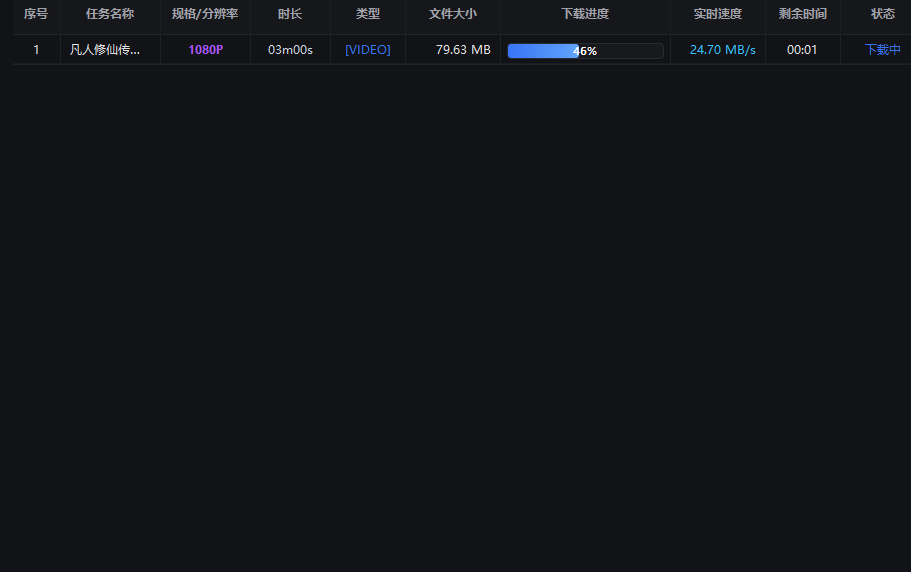
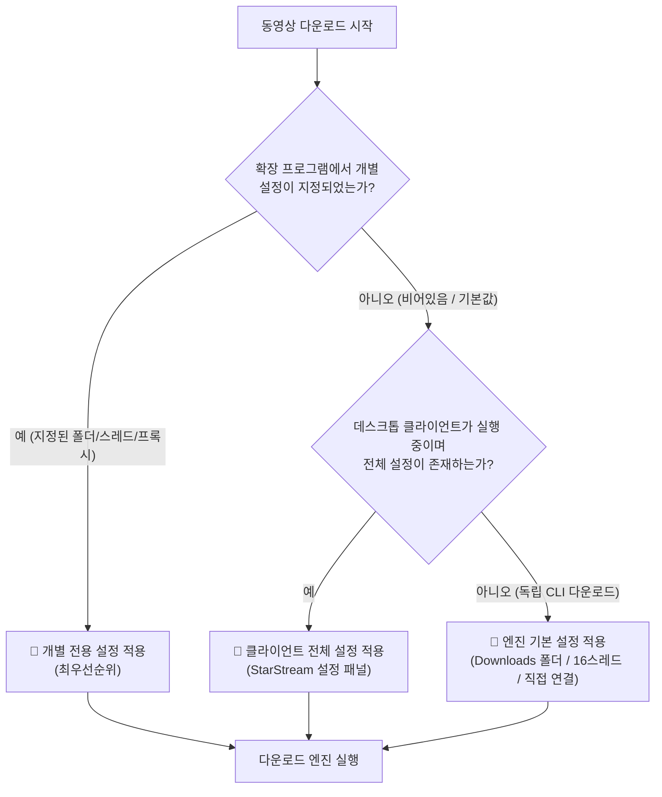

  <b>Language / 다국어:</b> 
  <a href="README.md">简体中文</a> •
  <a href="README_zh-TW.md">繁體中文</a> •
  <a href="README_en.md">English</a> •
  <a href="README_ja.md">日本語</a> •
  <a href="README_ko.md">한국어</a> •
  <a href="README_fr.md">Français</a> •
  <a href="README_de.md">Deutsch</a> •
  <a href="README_es.md">Español</a> •
  <a href="README_ru.md">Русский</a> •
  <a href="README_pt.md">Português</a>

  

# 🌟 StarStream Pro - 미디어 다운로더

**올인원 웹 오디오/비디오 스마트 스니퍼 확장 프로그램 + 산업용 고성능 멀티스레드 다운로더 + N_m3u8DL-RE & FFmpeg 코어 내장**

 

  
  &nbsp;&nbsp;
  

> [!IMPORTANT]
> ### 💡 최적의 콤비 가이드: 데스크톱 클라이언트와 브라우저 확장의 협력 필수!
> - **🧩 브라우저 스니퍼 확장 (프론트엔드 레이더)**: 웹 서핑 및 동영상 재생 시 M3U8, DASH (MPD), MP4 등의 실제 미디어 스트림을 자동 감지하여 플레이어 우측 상단에 다운로드 캡슐을 표시합니다;
> - **💻 데스크톱 클라이언트 (백엔드 엔진)**: 확장에서 전송된 다운로드 작업을 받아 내장된 **N_m3u8DL-RE** 고성능 엔진 및 **FFmpeg** 코어를 자동 호출하여 최고 24.7MB/s의 고속 멀티스레드 다운로드와 무손실 합성을 수행합니다;
> - **완벽한 연동 (IDM 소프트웨어와 IDM 브라우저 확장의 관계와 동일)**: 두 프로그램이 모두 준비되어야 합니다! 첫 사용 시 아래 [브라우저 확장 프로그램 설치 가이드](#-브라우저-확장-프로그램-설치-가이드)를 확인하여 Chrome 또는 Edge에 확장 프로그램을 추가해 주세요.

  <a href="#-스크린샷--시연">시연 화면</a> •
  <a href="#-버전-및-다운로드">다운로드</a> •
  <a href="#-핵심-기능">핵심 기능</a> •
  <a href="#-브라우저-확장-프로그램-설치-가이드">설치 가이드</a> •
  <a href="#-프록시-네트워크-설정">프록시 설정</a> •
  <a href="#-자주-묻는-질문-faq">FAQ</a> •
  <a href="#-면책-조항">면책 조항</a>

---

## 📸 스크린샷 & 시연

### 1. 데스크톱 대시보드 (다크 슬레이트 인더스트리얼 UI)
> 로컬 리스닝 포트 `18910` 준비 완료, `FFmpeg` 준비 완료, `N_m3u8DL (RE)` 엔진 준비 완료, 프록시 모드(직접 연결 / 시스템 / 수동) 원클릭 전환 지원.

  

---

### 2. 초고속 다중 작업 동시 다운로드 (실측 24.70 MB/s)
> 멀티태스킹 큐 스케줄링 및 밀리초 단위 이어받기 지원. 조각별 다운로드 진행률, 실시간 전송 속도(피크 **24.70 MB/s**), 예상 잔여 시간 실시간 표시.

  

---

### 3. 글로벌 스트리밍 자동 감지 (YouTube 예시)
> 각종 비디오 사이트에서 영상을 재생하면 플레이어 우측 상단에 플로팅 캡슐이 나타납니다. 해상도(예: 1280x720), 분리된 오디오 스트림, 재생 시간을 자동 분석하여 원클릭으로 데스크톱 전송 또는 URL 복사를 지원합니다.

  

---

## 📦 버전 및 다운로드

| 다운로드 항목 | 포함된 구성 요소 | 권장 용도 | 링크 |
|---|---|---|---|
| **⭐ 추천: StarStream_v3.1.2_Portable.zip 포터블 패키지** | **StarStream.exe** + **N_m3u8DL-RE** + **FFmpeg** + 확장 프로그램 소스 | 설치 불필요, 압축 해제 후 즉시 사용 가능 | [👉 포터블 패키지 다운로드](https://github.com/xuewexin/StarStream/releases/download/v3.1.2/StarStream_v3.1.2_Portable.zip) |
| **🧩 브라우저 스니퍼 확장 단독 패키지 (v3.1.2)** | 순수 확장 소스 (140KB), MV3 감지, 프록시 자동 정렬, 재생시간·화질순 정렬 | 웹 비디오 감지, 현재 탭 전용 표시, 내림차순 정렬 | [👉 Extension.zip 다운로드](https://github.com/xuewexin/StarStream/releases/download/v3.1.2/StarStream_Browser_Extension_v3.1.2.zip) |
| **GitHub Releases 공식 릴리스 페이지** | 전체 릴리스 내역, 업데이트 로그, 파일 확인 | 전체 버전 기록 확인 | [👉 Releases 페이지 방문](https://github.com/xuewexin/StarStream/releases) |

---

## ⚡ 핵심 기능

| 기능 모듈 | 설명 |
|---|---|
| **만능 리소스 스니핑** | M3U8 (HLS), MPD (DASH), MP4, FLV, WebM, TS, MP3, AAC 등 모든 스트림 및 다이렉트 링크 지원. `HTMLMediaElement.play`, `Blob`, `MediaSource`, `URL.createObjectURL`, `fetch/XHR` 심층 인터셉트. |
| **스마트 플로팅 캡슐** | 비디오 플레이어에 네이티브로 삽입되는 캡슐. 4K/1080P/720P 해상도, 재생 시간, 오디오 분리 스트림을 자동 식별하여 클라이언트로 즉시 전송. |
| **팝업 내장 플레이어** | 확장 프로그램 팝업 내에 가벼운 `hls.min.js` 재생 엔진이 탑재되어 다운로드 전 스트림을 미리보기 가능. |
| **듀얼 다운로드 엔진** | **스트리밍 엔진**: 최신 [N_m3u8DL-RE](https://github.com/nilaoda/N_m3u8DL-RE)를 호출하여 오디오/비디오 자동 믹싱 및 고속 분할 다운로드. **직접 링크 엔진**: Python 네이티브 멀티스레드 Range 분할 다운로드. |
| **동영상별 개별 설정** | 확장 프로그램 카드별로 저장 폴더, 동시 스레드 수(4/8/16/32), 개별 프록시 설정 지원. |
| **브라우저 프록시 자동 정렬** | 브라우저의 현재 프록시 출구를 감지하여 다운로더와 동기화함으로써 핫링크 방지로 인한 HTTP 403 Forbidden 오류 원천 차단. |
| **독립형 CLI 지원** | 클라이언트 실행 없이 터미널에서 즉시 다운로드할 수 있도록 헤더(Referer, User-Agent)가 포함된 완전한 `N_m3u8DL-RE` 명령어를 원클릭 복사. |
| **일괄 포맷 변환 센터** | 다중 파일 및 전체 디렉터리 일괄 변환 지원. 무손실 복사(`-c copy`), H.264/H.265 재인코딩, 고음질 오디오 추출 프리셋 제공. |
| **완료 및 실패 알림** | 작업 완료 또는 실패 시 화면 우측 하단에 알림 팝업 표시. [즉시 재생], [폴더 열기], [진단 로그] 바로가기 제공. |
| **표준 MP4 자동 변환** | 다운로드 완료 후 FFmpeg를 호출하여 표준 MP4로 무손실 리먹싱하고 `faststart` 메타데이터를 주입하여 즉시 재생 보장. |
| **스마트 오류 진단** | `Logs/download_errors.log`에 에러를 기록하고 HTTP 403, 만료된 토큰, AES-128 복호화 오류 등을 자동 진단하여 해결 방법 제시. |
| **디스크 캐시 정리** | 다운로드 중단으로 남은 `.tmp` 및 `.part` 조각 파일을 안전하게 스캔하여 삭제. |

---

## 🎯 동영상별 개별 설정 및 우선순위 규칙 (Priority Rules)

---

## 🌐 브라우저 프록시 자동 정렬 기능

### 다운로드 환경과 브라우저의 프록시를 일치시켜야 하는 이유
* 많은 동영상 사이트는 세그먼트 접근 권한을 **웹 브라우저의 접속 IP**와 엄격히 연결합니다.
* 브라우저는 프록시를 사용하고 다운로더는 직접 연결하거나 다른 프록시 IP를 사용할 경우, 서버 보안 정책에 의해 **HTTP 403 Forbidden** 접근 거부 에러가 발생합니다!
* **해결 방법**: 확장 프로그램의 다운로드 프록시를 **「브라우저 프록시 자동 정렬」**(기본 권장)로 설정하면 브라우저와 동일한 출구 IP가 사용되어 403 에러를 완벽히 방지할 수 있습니다.

---

## 🧩 브라우저 확장 프로그램 설치 가이드

> ⚠️ Chromium 계열 브라우저(Chrome / Edge / Brave)는 보안 정책상 비스토어 `.crx` 드래그 앤 드롭 설치를 차단합니다. **「개발자 모드」를 통한 폴더 로드가 공식적이고 영구적으로 안정적인 설치 방식입니다.**

### 1단계: 브라우저 확장 프로그램 관리 페이지 열기
- **Microsoft Edge**: 주소창에 `edge://extensions` 입력 후 Enter
- **Google Chrome**: 주소창에 `chrome://extensions` 입력 후 Enter

### 2단계: 「개발자 모드」 활성화
- 페이지 우측 상단의 **【개발자 모드】(Developer mode)** 스위치를 켭니다.
- 켜진 후 좌측 상단에 **【압축해제된 확장 프로그램을 로드합니다】** 버튼이 나타납니다.

### 3단계: 확장 프로그램 폴더 선택
1. **【압축해제된 확장 프로그램을 로드합니다】** 클릭.
2. 프로젝트 내부의 **`m3u8-sniffer-extension`** 폴더를 선택합니다.
3. 「폴더 선택」을 누르면 설치가 완료됩니다!
4. 브라우저 우측 상단 퍼즐 아이콘 🧩을 클릭하여 **「StarStream 미디어 스니퍼」**를 툴바에 고정하세요.

---

## ❓ 자주 묻는 질문 (FAQ)

<b>1. 패키지에 N_m3u8DL-RE 및 FFmpeg가 포함되어 있나요?</b>

<b>네, 완전히 내장되어 있습니다.</b> 포터블 배포 패키지에는 최신 N_m3u8DL-RE와 FFmpeg 실행 파일이 포함되어 있어 별도 설정 없이 바로 실행할 수 있습니다.

<b>2. 다운로드 완료 후 MP4로 자동 변환되나요?</b>

네! 기본적으로 표준 MP4 변환이 활성화되어 있으며, 무손실 리먹싱과 함께 <code>faststart</code> 메타데이터가 적용되어 모든 플레이어에서 매끄럽게 재생됩니다.

<b>3. 일부 비디오에서 HTTP 403 에러가 발생하는 이유는 무엇인가요?</b>

재생 시의 IP와 다운로드 시의 IP가 일치하지 않아 발생합니다. 확장 프로그램에서 다운로드 프록시를 <b>「브라우저 프록시 자동 정렬」</b>로 설정하면 동일한 IP로 요청되어 403 문제를 해결할 수 있습니다.

---

## ⚖️ 면책 조항

1. **기술 연구 및 개인 학습**: 본 프로젝트는 브라우저 네트워크 인터셉트 및 스트리밍 프로토콜 분석 연구, 개인의 합법적 오프라인 백업을 위한 오픈소스 프로젝트입니다.
2. **저작권 보호**: 사용자는 관련 국가 및 지역의 법률을 준수해야 하며 저작권자의 권리를 존중해야 합니다. 무단 상업적 이용 및 불법 유포를 금지합니다.
3. **책임의 한계**: 본 도구는 프로토콜 분석 및 로컬 저장 기능만을 제공하며 미디어 리소스를 호스팅하거나 배포하지 않습니다. 사용에 따른 법적 책임은 사용자 본인에게 있습니다.

---

## 📄 라이선스

본 프로젝트는 [MIT License](LICENSE)에 따라 배포됩니다. 
특별한 감사: [N_m3u8DL-RE](https://github.com/nilaoda/N_m3u8DL-RE) 및 [FFmpeg](https://ffmpeg.org/).
---

## 📬 개발자 문의 및 기술 지원

프로그램 사용 중 문제, 버그, 질문이 발생하거나 개선 사항 및 새로운 기능에 대한 제안이 있으시면 언제든지 이메일로 개발자에게 문의해 주세요:

- **QQ 메일**: [2792893068@qq.com](mailto:2792893068@qq.com)
- **Gmail**: [lepa23216@gmail.com](mailto:lepa23216@gmail.com)

메일을 확인하는 대로 신속하게 답변 및 조치해 드리겠습니다. 여러분의 성원과 피드백에 감사드립니다!
