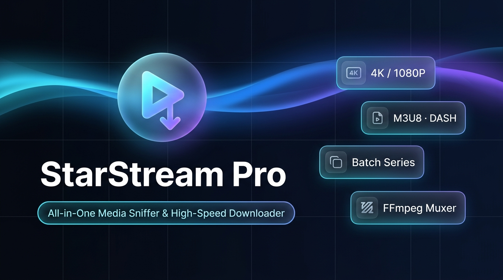
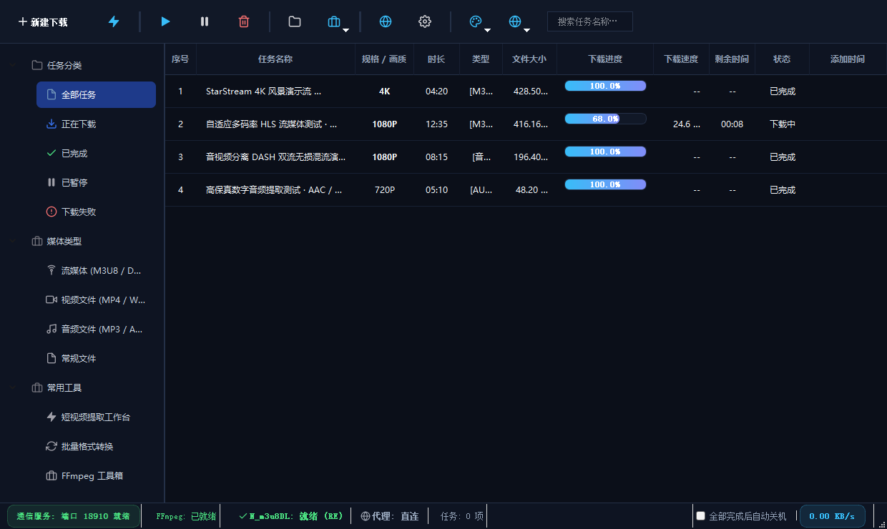

  <b>Language / 다국어:</b> 
  <a href="README.md">简体中文</a> •
  <a href="README_zh-TW.md">繁體中文</a> •
  <a href="README_en.md">English</a> •
  <a href="README_ja.md">日本語</a> •
  <a href="README_ko.md">한국어</a> •
  <a href="README_fr.md">Français</a> •
  <a href="README_de.md">Deutsch</a> •
  <a href="README_es.md">Español</a> •
  <a href="README_ru.md">Русский</a> •
  <a href="README_pt.md">Português</a>

  

# StarStream Pro - 통합 미디어 다운로더

**웹 미디어 스니퍼 확장 (MV3) · 고속 멀티스레드 데스크톱 클라이언트 · 네이티브 Android 앱**

 

  
  &nbsp;&nbsp;
  
  &nbsp;&nbsp;
  
  &nbsp;&nbsp;
  

---

## 💡 왜 StarStream Pro인가요?

| 자주 겪는 문제 | StarStream Pro의 해결 방식 |
|---|---|
| 영상·음성 분리 스트림 다운로드 시 무음/병합 실패 | Bilibili, Douyin 등 모든 분리 스트림 사이트 자동 페어링 + **FFmpeg / FFmpegKit** 무손실 MP4 병합 |
| 연속극/강의 시리즈 일괄 저장 및 파일명 정리 | **영상 제목 + 회차** 형식으로 자동 명명하여 일괄 다운로드 |
| 까다로운 핫링크 차단 및 CDN 속도 제한 | 브라우저 `Cookie` / `Referer` 동기화 및 속도 저하 시 자동 토큰 갱신 가속 |
| 원하는 확장자만 골라 캡처 & 받으면서 바로 보기 | IDM 스타일 확장자 추가/삭제, 다운로드 중 실시간 재생 및 외부 플레이어 미리보기 지원 |

---

  

---

## 📸 실제 구동 화면

  

<table>
  <tr>
    <td width="50%" align="center"> 웹 비디오 플로팅 캡처</td>
    <td width="50%" align="center"> 내장 FFmpeg 멀티미디어 툴박스</td>
  </tr>
  <tr>
    <td width="50%" align="center"> 새 작업 및 프록시 설정</td>
    <td width="50%" align="center"> 스레드 및 화질 향상 설정</td>
  </tr>
  <tr>
    <td width="50%" align="center"> 데스크톱 실시간 모니터</td>
    <td width="50%" align="center"> 플로팅 속도 모니터링 위젯</td>
  </tr>
</table>

---

## 📱 Android 모바일 주요 기능

- **내장 멀티 커널 브라우저 & 신원 새로고침**, 당겨서 새로고침, 접이식 북마크 폴더 및 방문 기록/열린 탭 영구 보존.
- **다운로드 중 실시간 재생 & 외부 플레이어 온라인 미리보기**.
- **동시 다운로드 작업 수, 멀티스레드 수 및 사용자 지정 저장 폴더(SAF) 설정**.

Author: `xuewexin` · [2792893068@qq.com](mailto:2792893068@qq.com) / [lepa23216@gmail.com](mailto:lepa23216@gmail.com) · MIT License
