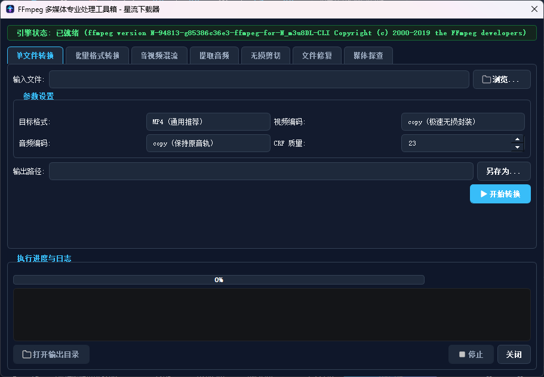

  <b>Language / Язык :</b> 
  <a href="README.md">简体中文</a> •
  <a href="README_zh-TW.md">繁體中文</a> •
  <a href="README_en.md">English</a> •
  <a href="README_ja.md">日本語</a> •
  <a href="README_ko.md">한국어</a> •
  <a href="README_fr.md">Français</a> •
  <a href="README_de.md">Deutsch</a> •
  <a href="README_es.md">Español</a> •
  <a href="README_ru.md">Русский</a> •
  <a href="README_pt.md">Português</a>

  

# StarStream Pro — Загрузчик Медиа

**Веб-сниффер (MV3) · Многопоточный десктопный клиент · Нативное приложение Android**

 

  
  &nbsp;&nbsp;
  
  &nbsp;&nbsp;
  
  &nbsp;&nbsp;
  

---

## 💡 Почему выбирают StarStream Pro?

| Частая проблема | Техническое решение StarStream Pro |
|---|---|
| Раздельные аудио/видео потоки без звука или сбой слияния | Автоматическое сопряжение потоков на всех сайтах + слияние без потерь через **FFmpeg / FFmpegKit** в MP4 |
| Утомительная загрузка сериалов без понятных имён | Пакетный парсер именует файлы в формате **Название видео + Номер серии** |
| Ошибки 403/412 и ограничение скорости CDN | Синхронизация `Cookie` / `Referer` и автоматическое обновление токенов для разгона загрузки |
| Жёсткие фильтры типов файлов и ожидание просмотра | Редактируемый список расширений как в IDM, просмотр во время скачивания и внешний прокси-плеер |

---

  

---

## 📸 Скриншоты интерфейса

  

<table>
  <tr>
    <td width="50%" align="center"> Захват видео на веб-странице</td>
    <td width="50%" align="center"> Встроенный инструмент FFmpeg</td>
  </tr>
  <tr>
    <td width="50%" align="center"> Создание задачи и прокси</td>
    <td width="50%" align="center"> Настройки и улучшение видео</td>
  </tr>
  <tr>
    <td width="50%" align="center"> Панель быстрого мониторинга</td>
    <td width="50%" align="center"> Плавающий виджет скорости</td>
  </tr>
</table>

---

## 📱 Возможности Android

- Встроенный браузер с переключением профилей и **обновлением идентификатора**, сворачиваемые папки закладок, сохранение истории и открытых вкладок при выходе.
- Воспроизведение во время загрузки и онлайн-превью во внешних плеерах.
- Настройка числа одновременных загрузок (1–6), потоков (2–24) и произвольной папки сохранения (SAF).

Автор: `xuewexin` · [2792893068@qq.com](mailto:2792893068@qq.com) / [lepa23216@gmail.com](mailto:lepa23216@gmail.com) · Лицензия MIT
