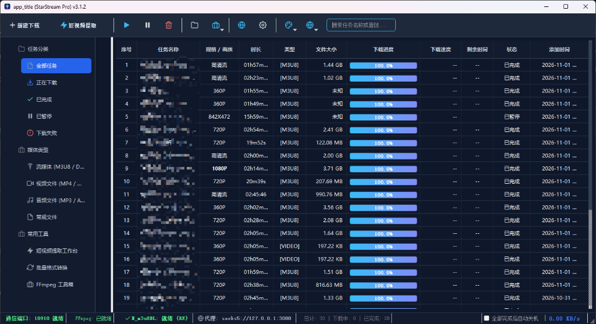
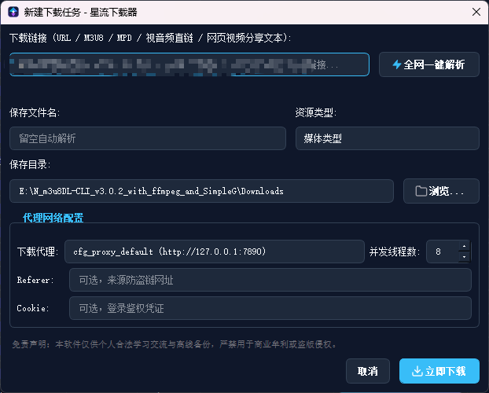
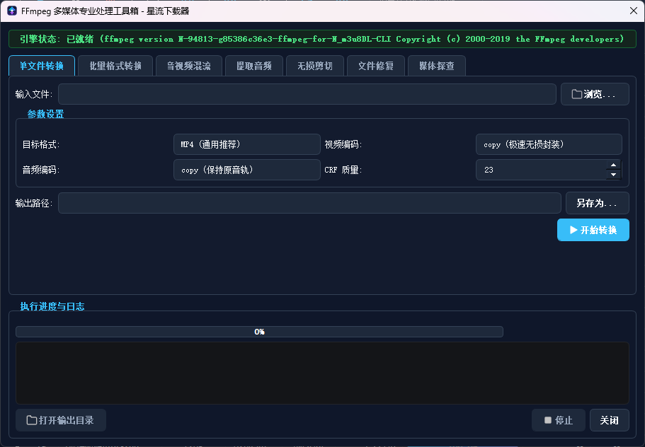
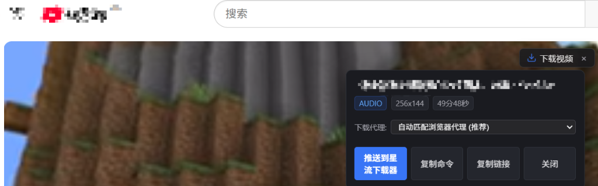
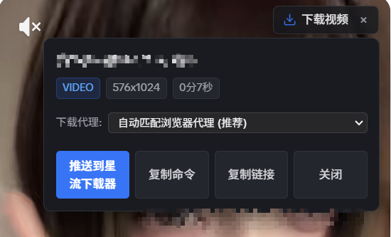
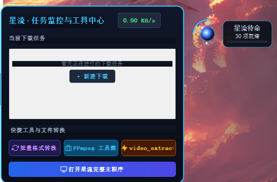
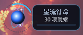
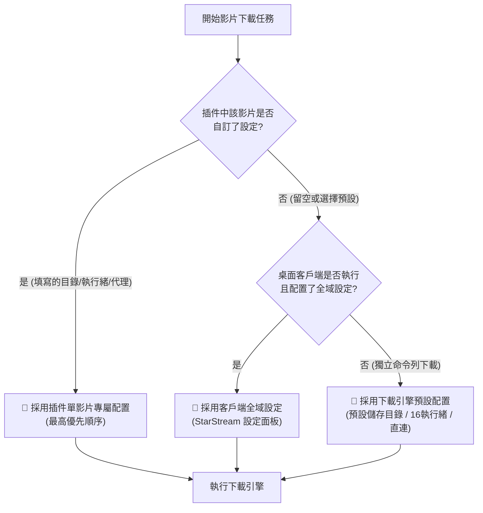

  <b>Language / 多語言:</b> 
  <a href="README.md">简体中文</a> •
  <a href="README_zh-TW.md">繁體中文</a> •
  <a href="README_en.md">English</a> •
  <a href="README_ja.md">日本語</a> •
  <a href="README_ko.md">한국어</a> •
  <a href="README_fr.md">Français</a> •
  <a href="README_de.md">Deutsch</a> •
  <a href="README_es.md">Español</a> •
  <a href="README_ru.md">Русский</a> •
  <a href="README_pt.md">Português</a>

  

# 🌟 星流媒體下載器 (StarStream Pro)

**全能網頁影音智慧探測擴充功能 + IDM 工業級多執行緒下載客戶端 + 內建 N_m3u8DL-RE 與 FFmpeg 核心**

 

  
  &nbsp;&nbsp;
  
  &nbsp;&nbsp;
  
  &nbsp;&nbsp;
  

> [!IMPORTANT]
> ### 💡 黃金拍檔使用說明：桌面軟體必須搭配瀏覽器插件協同使用！
> - **🧩 瀏覽器探測插件（前端雷達）**：負責在您日常瀏覽網頁、播放影片時，全自動深度抓取 M3U8、DASH (MPD)、MP4 等真實網路數據流，並在播放器右上角智慧浮現【下載影片】操作膠囊；
> - **💻 桌面下載客戶端（後端引擎）**：負責接收擴充功能推送的影音任務，自動排程內建的 **N_m3u8DL-RE** 高效能引擎與 **FFmpeg** 核心，執行 24.7MB/s 工業級高並發分塊下載與無損混流封裝；
> - **兩者協同配合（類似 IDM 軟體與 IDM 瀏覽器擴充功能）**：缺一不可！初次使用請務必參考下方的 [瀏覽器插件匯入教學](#-瀏覽器插件匯入教學) 將擴充功能匯入您的 Chrome/Edge 瀏覽器。

  <a href="#-應用實機展示">實機展示</a> •
  <a href="#-軟體版本與下載">版本下載</a> •
  <a href="#-核心特性">核心特性</a> •
  <a href="#-瀏覽器插件匯入教學">插件教學</a> •
  <a href="#-代理網路配置說明">代理設定</a> •
  <a href="#-常見問題-faq">常見問題</a> •
  <a href="#-免責聲明-disclaimer">免責聲明</a>

---

## 📸 應用實機展示

### 1. 桌面端主控中心 (沉浸式 Dark Slate 灰藍工業級 UI)
> 全向量高精度圖示，全狀態監控一目了然：本機監聽連接埠 `18910` 就緒、`FFmpeg` 就緒、`N_m3u8DL (RE)` 引擎就緒、網路代理即時狀態指示與一鍵切換。

  

---

### 2. 新建下載任務與深度逆向解析 (智慧代理與獨立並發配置)
> 支援全網主流影片分享口令與連結一鍵貼上解析。針對單一任務獨立配置並發執行緒數、專用儲存目錄與網路代理模式。

  

---

### 3. FFmpeg 多媒體專業處理工具箱 (格式轉換與影音後處理)
> 開箱即用內建專業級媒體工具箱：支援單檔/批次格式轉換（MP4/MKV/TS/MOV）、影音混流、無損音訊擷取、影片無損剪切與媒體探測。

  

---

### 4. 海外串流媒體無感探測 (以 YouTube 為例)
> 播放各類海外影片時，播放器右上角無感浮現【下載影片】膠囊。自動擷取真實解析度、音訊流與播放時長，自動對齊瀏覽器代理並一鍵直推桌面端。

  

---

### 5. 主流網頁影片智慧探測與直推下載 (自動對齊瀏覽器代理)
> 於網頁播放影片時，播放器右上角無感浮現下載膠囊。直觀呈現真實解析度、時長與格式，一鍵對齊瀏覽器代理並推送至桌面客戶端高速下載。

  

---

### 6. 桌面任務監控與便捷工具中心
> 點擊懸浮球即刻展開監控面板：即時查看進行中的下載任務進度、全局傳輸速率，並一鍵呼出格式轉換、FFmpeg 工具箱與短影音擷取工作台。

  

---

### 7. 靈動微型太空星球懸浮球 (隨時掌握任務動態)
> 極具科技感的迷你星球懸浮球，支援桌面任意拖曳、貼邊吸附與多級縮放，即時掌握就緒任務數與全局傳輸動態。

  

## 📦 軟體版本與下載 (Releases)

您可以透過以下方式輕鬆獲取並使用星流媒體下載器最新發佈版本：

| 下載方式 | 包含組件 | 適用場景 | 下載連結 |
|---|---|---|---|
| **⭐ 推薦：StarStream_v3.2.2_Portable.zip 全套免安裝包** | 內建完整 **StarStream.exe** + **N_m3u8DL-RE** + **FFmpeg** + 瀏覽器插件源碼 | **強烈推薦未安裝 FFmpeg / N_m3u8DL 的使用者**，解壓即用，全套核心內建 | [👉 下載 Portable 免安裝包](https://github.com/xuewexin/StarStream/releases/download/v3.2.2/StarStream_v3.2.2_Portable.zip) |
| **🚀 獨立單檔案版：StarStream.exe (82.5MB)** | 最新編譯獨立單檔案可執行程式 (內建全部相依性) | **適合本機已有 FFmpeg 或 N_m3u8DL 的使用者**，自動全盤掃描識別相依性；**請放入獨立空白資料夾執行** | [👉 點選直接下載 StarStream.exe](https://github.com/xuewexin/StarStream/releases/download/v3.2.2/StarStream.exe) |
| **🧩 必裝搭檔：瀏覽器探測插件獨立包 (v3.2.2)** | 純插件原始碼包 (僅 171KB)，含 MV3 探測/自動匹配瀏覽器代理/畫質時長智慧排序 | 探測網頁影片、當前頁面純淨展示、按時長畫質降序置頂 | [👉 下載 Extension.zip (171KB)](https://github.com/xuewexin/StarStream/releases/download/v3.2.2/StarStream_Browser_Extension_v3.2.2.zip) |
| **GitHub Releases 官方發行版主頁** | 查看所有發佈版本、更新日誌與資源列表 | 追溯所有更新與校驗包 | [👉 瀏覽 Releases 頁面](https://github.com/xuewexin/StarStream/releases) |

> 💡 **下載與使用重要建議 (必讀指南)**：
> 1. **未安裝 FFmpeg 與 N_m3u8DL 的使用者**：
>    👉 **強烈建議直接下載【便攜完整包 (`StarStream_v3.2.2_Portable.zip`)】**！便攜包內已預置並配置好了全部必需的 `ffmpeg.exe` 與 `N_m3u8DL-RE.exe` 核心引擎，解壓即可直接使用，無需任何環境配置。
> 2. **本機已有 FFmpeg 或 N_m3u8DL 的使用者**：
>    👉 **可以直接下載單檔案【獨立主程式 (`StarStream.exe`)】**！星流在首次啟動時會自動全盤掃描系統環境變數（`PATH`）與常見目錄，智慧識別並自動掛載這兩個前置依賴工具，無需重複配置。
> 3. **⚠️ 執行注意事項 (強烈建議)**：
>    若您下載的是單檔案獨立版 `StarStream.exe`，**請務必將該 exe 檔案放置在一個全新的空資料夾（如 `D:\StarStream\`）中執行**！軟體在執行過程中會在 exe 所在目錄下自動生成本機資料庫、設定檔、日誌記錄及暫存工作目錄。將 exe 放入獨立的乾淨資料夾中可防止桌面或下載目錄混亂，便於日常管理與清理。

---

## ⚔️ 同類開源專案橫向對比與選型指南 (Comparison & Alternatives)

很多使用者在尋找影音下載工具時常有疑問：**「星流 (StarStream) 與『貓抓 (CatCatch)』、『SimpleG』、『N_m3u8DL-RE 命令列』、『yt-dlp』或『Video DownloadHelper』相比有什麼區別？我該如何選擇？」**

下表為您直觀梳理核心能力對比：

| 功能維度 / 核心特性 | 🌟 星流 (StarStream Pro) | 🐱 貓抓 (Cat-Catch) | 🛠️ SimpleG (N_m3u8DL原版GUI) | ⚡ yt-dlp / CLI 工具 | 🦊 Video DownloadHelper |
| :--- | :---: | :---: | :---: | :---: | :---: |
| **產品形態** | **桌面端 + 瀏覽器外掛雙模極速聯動** | 純瀏覽器擴充套件 | 傳統單體 Windows 客戶端 | 純命令列終端程式 | 瀏覽器擴充套件 + 付費外掛軟體 |
| **底層下載引擎** | **原生內建 N_m3u8DL-RE + FFmpeg 工業級引擎** | 瀏覽器內建 Blob / Fetch 記憶體下載 | 舊版 N_m3u8DL-CLI v3.0.2 核心 | yt-dlp Python 腳本引擎 | 擴充套件內建 / 需裝背景服務 |
| **高並發多執行緒下載** | **✅ 支援 (4 ~ 32 執行緒極速拉取，實測 24MB/s+)** | ❌ 僅單執行緒/低並發 (大檔案極慢) | ⚠️ 基礎多執行緒支援 | 需手動配置複雜命令列參數 | 需付費購買授權解鎖 |
| **音訊影像分離混流** | **✅ 自動混流並秒級封裝為標準 MP4 (faststart)** | ❌ 無法自動處理音訊與影像分離串流 | ⚠️ 基礎轉碼合併 | 支援呼叫 FFmpeg 合併 | ❌ 免費版限制時長/加浮水印 |
| **瀏覽器代理自動對齊** | **✅ 深度對齊瀏覽器出口 IP (從根源徹底杜絕 403)** | 僅走瀏覽器當前代理 | ❌ 無法感知瀏覽器當前代理狀態 | 需手動查詢並傳 `--proxy` 參數 | ❌ 不支援智慧代理對齊 |
| **網頁播放器內嵌操作** | **✅ 影片右上角原生注入天藍色下載操作膠囊** | ❌ 必須手動點選外掛選單 | ❌ 無瀏覽器互動，需手動複製貼上 URL | ❌ 純文字命令列輸入 | 需點選瀏覽器擴充套件圖示 |
| **桌面迷你懸浮監控掛件** | **✅ 炫酷星球呼吸懸浮掛件 + 任務監控微面板** | ❌ 無桌面端掛件 | ❌ 無桌面掛件 | ❌ 無圖形介面掛件 | ❌ 無桌面端掛件 |
| **全球多語言支援** | **✅ 完整適配 10 國主流語言與專屬 README 文件** | 僅繁簡中文 / 英文 | 僅簡體中文 | 英文終端輸出 | 多語言支援 |
| **開源免費與商用限制** | **✅ 100% 永久開源免費 (基於 MIT 協議)** | 開源免費 | 開源免費 | 開源免費 (Unlicense) | 商業軟體 (限制功能/付費) |

---

## ⚡ 核心特性

| 功能模組 | 核心能力描述 |
|---|---|
| **全能資源探測** | 自動抓取 M3U8 (HLS)、MPD (DASH)、MP4、FLV、WebM、TS、MP3、AAC 等全部串流媒體與直鏈；深度攔截網頁 `HTMLMediaElement.play`、`Blob`、`MediaSource`、`URL.createObjectURL` 與 `fetch/XHR` |
| **智慧懸浮膠囊** | 網頁影片播放器內原生注入天藍色懸浮操作膠囊，自動識別分集、解析度規格（4K/1080P/720P）、時長與音軌分離串流，一鍵投送客戶端 |
| **彈窗內建播放器** | 擴充功能彈窗內建輕量 `hls.min.js` 播放引擎，支援即時預覽 M3U8 串流媒體，核對畫面音畫無誤後再發起下載 |
| **雙下載引擎體系** | **串流媒體引擎**：排程最新 [N_m3u8DL-RE](https://github.com/nilaoda/N_m3u8DL-RE) 高效能引擎，自動解析影音混流並分段拉取； **直鏈引擎**：原生 Python 多執行緒 Range 分塊高並發下載 |
| **單影片專屬設定** | 插件內每個影片卡片均支援展開專屬配置面板，可針對特定影片單獨指定**儲存目錄**、**並發執行緒數**（4/8/16/32）與**下載代理** |
| **瀏覽器代理自動對齊** | 插件自動偵測當前瀏覽器實際代理位址，實現**下載網路出口與影片播放網頁出口完全對齊**，徹底杜絕防盜鏈 IP 不一致導致的 HTTP 403 鑑權失敗 |
| **脫離客戶端獨立執行** | 插件可與 `N_m3u8DL-RE` 直接搭配使用！一鍵產生並複製完整命令列，免啟動桌面 exe 客戶端亦可直接在終端機中極速下載 |
| **批次格式轉換中心** | 全新內建批次多媒體轉換中心，支援多檔案與整目錄批次掃描，提供智慧極速無損拷貝 (-c copy，秒級無損封裝轉碼)、H.264/H.265/高品質音訊擷取等預設方案 |
| **完成與失敗彈窗提醒** | 任務下載完成或失敗時，螢幕右下角自動彈出沉浸式浮窗提醒，支援直接點擊【立即播放】、【開啟目錄】或失敗時一鍵呼叫【詳細診斷與日誌】 |
| **媒體格式自動處理** | 下載完成後自動呼叫內建 FFmpeg 進行無損轉封裝，產生通用 MP4 格式並注入 `faststart` 標記，確保任意播放器秒開起播 |
| **多節點代理網路池** | 全面支援 **直連**、**跟隨 Windows 系統代理**、**手動多代理池**（相容 Clash 7890、v2rayN 10808/10809/3080 及各類 HTTP/SOCKS5 本地連接埠代理） |
| **智慧錯誤診斷與日誌** | 遇到下載失敗時自動記錄錯誤日誌至 `Logs/download_errors.log`，深度智慧診斷失敗根本原因（HTTP 403 防盜鏈、401、404、AES-128 解密、代理連接埠未開啟等） |
| **磁碟快取深度清理** | 內建磁碟清理精靈，一鍵掃描並粉碎下載中斷殘留的 `.tmp`、`.part` 分片碎片，安全釋放硬碟空間 |

---

## 🎯 單影片獨立配置與三級優先順序機制 (Priority Rules)

---

## 🌐 瀏覽器代理自動偵測與對齊功能

### 為什麼需要讓下載環境與瀏覽器處於同一代理？
* 許多串流媒體平台在網頁端播放時使用的是瀏覽器專屬的代理通道。
* 伺服器下發給網頁的 M3U8 切片清單往往包含與**當前連線 IP 強綁定的防盜鏈 Token 鑑權憑證**。
* **如果桌面下載器使用直連、或與瀏覽器走不同的代理出口 IP，就會觸發目標站點的防盜鏈風控，導致 HTTP 403 權限被拒絕或分片拉取失敗！**
* **解決方案**：在插件下載設定中保持選擇**「自動匹配可用代理」**（預設推薦），徹底杜絕 403 錯誤。

---

## 🧩 瀏覽器插件匯入教學

> ⚠️ Chromium 核心瀏覽器（Edge / Chrome / Brave）基於安全機制已阻擋外部直接拖拉安裝 `.crx` 包。**透過「開發人員模式」載入未封裝資料夾是官方唯一長久穩定生效的匯入方式。**

### 第一步：開啟瀏覽器的擴充功能管理頁
- **Edge 瀏覽器**：在網址列輸入 `edge://extensions` 並按下 Enter
- **Chrome 瀏覽器**：在網址列輸入 `chrome://extensions` 並按下 Enter

### 第二步：開啟「開發人員模式」
- 在管理頁面的右上角，將 **【開發人員模式】(Developer mode)** 開關切換為開啟。
- 開啟後，左上方將出現 **【載入未封裝項目】** 按鈕。

### 第三步：選取擴充功能源碼目錄
1. 點擊 **【載入未封裝項目】**。
2. 在彈出的檔案選取視窗中，定位並選中專案目錄下的 **`m3u8-sniffer-extension`** 資料夾。
3. 點選「選取資料夾」，插件即刻匯入完成！
4. 點選瀏覽器工具列的拼圖圖示 🧩，將 **「星流媒體探測器」** 固定至工具列即可使用。

---

## ❓ 常見問題 (FAQ)

<b>1. 安裝包裡面包含 N_m3u8DL-RE 引擎嗎？</b>

<b>包含！完全內建，免額外設定。</b> 
發行版 <code>StarStream.exe</code> 已完整內建最新的 N_m3u8DL-RE 高效能引擎與 FFmpeg 核心。下載後解壓縮即可直接使用。

<b>2. 下載後的影片會自動轉為 MP4 格式嗎？</b>

是的！星流媒體下載器預設開啟【自動轉為標準 MP4 格式】，內建整合 FFmpeg 進行無損封裝合併，並自動寫入 <code>faststart</code> 元數據標記，確保在所有播放器秒開起播。

<b>3. 為什麼部分影片下載會報 HTTP 403 錯誤？</b>

許多影音網站會將切片存取權限與網頁訪問時的出口 IP 綁定。請將插件下載代理選擇為<b>「自動匹配瀏覽器代理」</b>，下載器將與瀏覽器保持完全相同的出口節點與 IP，即可完美解決 403 錯誤。

---

## ⚖️ 免責聲明 (Disclaimer)

1. **技術研究與個人學習**：本專案屬於開源個人技術探索，旨在研究瀏覽器網路底層攔截機制、串流媒體協定解析技術與多執行緒分塊下載演算法，僅供學習交流及個人合法離線備份之用。
2. **智慧財產權與版權保護**：請使用者遵守所在國家或地區之法律法規，尊重著作權人權益。嚴禁將本工具用於商業營利、二次分發或侵權非法散佈行為。
3. **免責與法律責任界定**：本工具僅提供串流媒體協定解析與本機儲存技術，不提供亦不代管任何影音資源。使用者因使用本工具產生的任何法律責任由使用者獨立承擔。

---

## 📄 開源授權

本專案採用 [MIT License](LICENSE) 授權開源。 
特別致謝：[N_m3u8DL-RE](https://github.com/nilaoda/N_m3u8DL-RE) 與 [FFmpeg](https://ffmpeg.org/)。
---

## 📬 聯絡作者與技術支援

如果您在使用過程中遇到任何問題、功能 Bug、操作疑惑，或有寶貴的改進建議與新功能需求，歡迎隨時透過電子郵件聯絡作者：

- **QQ 信箱**：[2792893068@qq.com](mailto:2792893068@qq.com)
- **Gmail**：[lepa23216@gmail.com](mailto:lepa23216@gmail.com)

收到信件後會儘快為您解答與處理！感謝您的支持與反饋！

---

### 🏷️ 核心技术与检索索引 (Search Topics & Keywords)
`m3u8-downloader` • `video-downloader` • `catcatch-alternative` • `n-m3u8dl-re-gui` • `simpleg-upgrade` • `ffmpeg-gui` • `hls-stream-sniffer` • `dash-mpd-downloader` • `browser-extension` • `bilibili-video-download` • `douyin-watermark-free` • `chrome-video-extractor` • `yt-dlp-gui` • `stream-recorder` • `idm-alternative` • `media-downloader` • `video-sniffer` • `hls-downloader`
