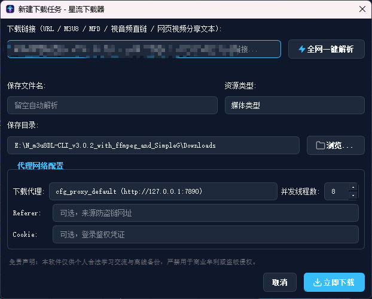

  <b>Language / 多語言:</b> 
  <a href="README.md">简体中文</a> •
  <a href="README_zh-TW.md">繁體中文</a> •
  <a href="README_en.md">English</a> •
  <a href="README_ja.md">日本語</a> •
  <a href="README_ko.md">한국어</a> •
  <a href="README_fr.md">Français</a> •
  <a href="README_de.md">Deutsch</a> •
  <a href="README_es.md">Español</a> •
  <a href="README_ru.md">Русский</a> •
  <a href="README_pt.md">Português</a>

  

  

# 星流媒體下載器 (StarStream Pro)

**全平台網頁影音與檔案智慧探測擴充 · 工業級多執行緒並發桌面端 · 原生硬解混流 Android 客戶端**

 

  
  &nbsp;&nbsp;
  
  &nbsp;&nbsp;
  
  &nbsp;&nbsp;
  

---

## 📸 實機運行展示

  

<table>
  <tr>
    <td width="50%" align="center">
      <b>網頁影音懸浮探測與一鍵推送</b> 
      
    </td>
    <td width="50%" align="center">
      <b>FFmpeg 專業多媒體處理工具箱</b> 
      
    </td>
  </tr>
  <tr>
    <td width="50%" align="center">
      <b>新建任務與多執行緒代理配置</b> 
      
    </td>
    <td width="50%" align="center">
      <b>系統全域設定與本地畫質增強</b> 
      
    </td>
  </tr>
  <tr>
    <td width="50%" align="center">
      <b>桌面即時監控微面板</b> 
      
    </td>
    <td width="50%" align="center">
      <b>極簡星球懸浮監控掛件</b> 
      
    </td>
  </tr>
</table>

---

## 📱 Android 手機端重點特性

- 內建多核心極簡瀏覽器與一鍵 **「身份刷新」**，支持網頁與清單下拉刷新。
- **跨重啟狀態持久化**：完整儲存瀏覽歷史記錄、打開的分頁與當前訪問頁面；單頁面左滑返回先回主頁再退出。
- **可折疊收藏資料夾**：支援建立自訂名稱收藏資料夾，書籤與最近訪問區塊可隨時折疊展開。
- **邊下邊看 & 外部線上預覽**：下載中即可透過本地防盜鏈代理緩衝播放，探測到的影片可直接呼叫外部播放器線上預覽。
- **彈性設定**：支援同時下載任務上限（1~6）、多執行緒（2~24）與系統自訂儲存目錄選擇。

## 📬 聯繫作者與授權條款
- 作者：`xuewexin` · 信箱：[2792893068@qq.com](mailto:2792893068@qq.com) / [lepa23216@gmail.com](mailto:lepa23216@gmail.com)
- 本專案採用 [MIT License](LICENSE) 開源，僅供技術學習與個人合法離線備份之用。
